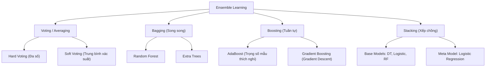
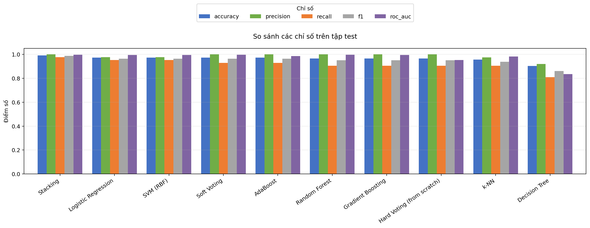
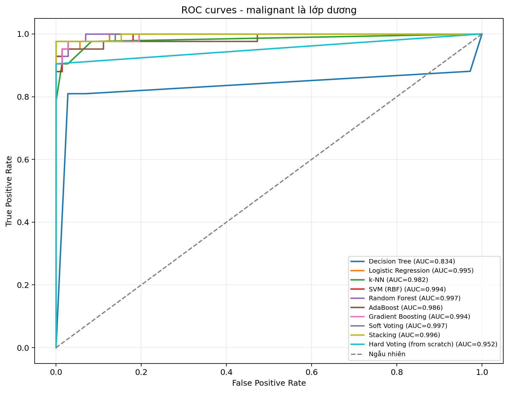
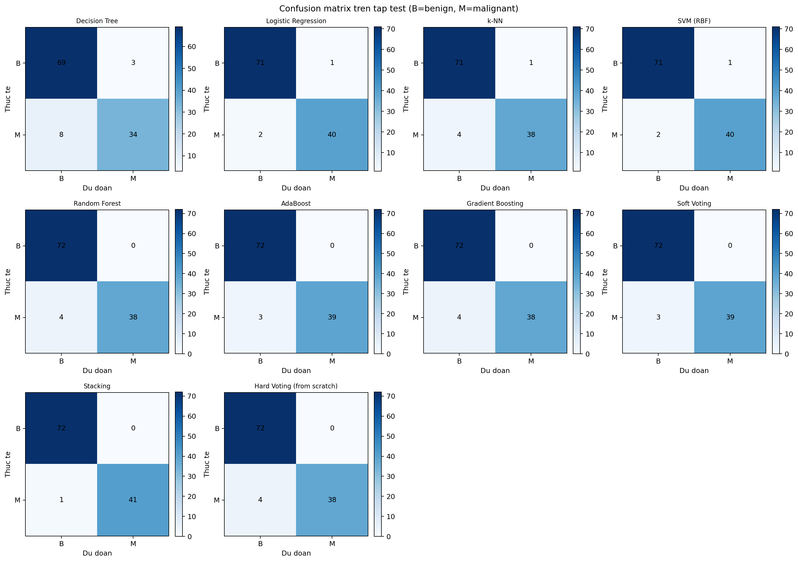
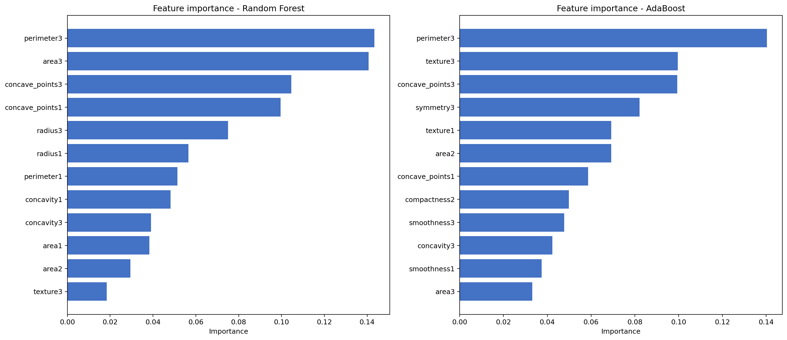

# 🔬 Ensemble Learning: Lý Thuyết, Tính Toán Số Học & Thực Nghiệm Phân Loại Ung Thư Vú (UCI WDBC)

[](https://www.python.org/)
[](https://scikit-learn.org/)
[](https://pandas.pydata.org/)
[](https://numpy.org/)
[-brightgreen.svg)](tests/test_pipeline.py)
[](https://archive.ics.uci.edu/dataset/17/breast+cancer+wisconsin+diagnostic)
[](docs/KE_HOACH_VA_PHAN_CONG.md)

> **Cảnh báo học thuật & Y khoa:**  
> Dự án được thực hiện phục vụ mục đích nghiên cứu, học tập trong khuôn khổ môn học **Nhập môn Học máy (Introduction to Machine Learning)**. Các kết quả dự đoán và chỉ số đánh giá của mô hình **không phải là chẩn đoán y khoa chính thức**, không có giá trị pháp lý hay thay thế phác đồ điều trị của bác sĩ chuyên khoa.

---

## 👥 Thông Tin Đề Tài & Nhóm Tác Giả

* **Đơn vị:** Khoa Công nghệ Thông tin – Trường Đại học Tôn Đức Thắng (TDTU)
* **Môn học:** Nhập môn Học máy (*Introduction to Machine Learning*)
* **Đề tài:** **Học kết hợp (Ensemble Learning)** *(Xác định theo quy tắc Modulo 8: $(7 + 0 + 6) \pmod 8 = 5$)*
* **Quy cách đặt tên hồ sơ nộp:** `52400217_52400230_52400186.zip`

### 📋 Bảng phân công nhiệm vụ (3 Gói công việc độc lập)

| STT | Họ và tên | Mã số sinh viên | Chữ số cuối | Gói nhiệm vụ phụ trách | Vai trò chính trong dự án |
| :---: | :--- | :---: | :---: | :---: | :--- |
| 1 | **Trần Hữu Nam** | **52400217** | 7 | **Gói A** | Lý thuyết nền tảng (Condorcet, Bias-Variance, Bagging/Boosting/Stacking) & Tổng hợp định dạng báo cáo Word/PDF. |
| 2 | **Nguyễn Anh Hào** | **52400186** | 6 | **Gói B** | Thiết kế thuật toán, giải tay ví dụ số học AdaBoost từng bước (Toy Dataset 8 mẫu qua 3 vòng lặp) & Thiết kế bộ Slide 15 trang chuẩn. |
| 3 | **Nguyễn Trọng Quý** | **52400230** | 0 | **Gói C** | Xây dựng pipeline xử lý dữ liệu UCI WDBC, lập trình mô hình Python (from-scratch + scikit-learn), thực nghiệm & xuất báo cáo số liệu. |

---

## 📑 Mục Lục

- [1. Giới Thiệu Tổng Quan](#1-giới-thiệu-tổng-quan)
- [2. Cơ Sở Lý Thuyết Ensemble Learning](#2-cơ-sở-lý-thuyết-ensemble-learning)
  - [2.1. Bản chất & Nguyên lý hoạt động](#21-bản-chất--nguyên-lý-hoạt-động)
  - [2.2. Định lý bồi thẩm đoàn Condorcet (Condorcet's Jury Theorem)](#22-định-lý-bồi-thẩm-đoàn-condorcet-condorcets-jury-theorem)
  - [2.3. Đánh đổi Bias - Variance (Bias-Variance Tradeoff)](#23-đánh-đổi-bias---variance-bias-variance-tradeoff)
  - [2.4. Phân loại các phương pháp Ensemble chính](#24-phân-loại-các-phương-pháp-ensemble-chính)
- [3. Điểm Nhấn: Tính Toán Số Học AdaBoost Từng Bước (Gói B)](#3-điểm-nhấn-tính-toán-số-học-adaboost-từng-bước-gói-b)
- [4. Bài Toán Ứng Dụng & Bộ Dữ Liệu UCI WDBC](#4-bài-toán-ứng-dụng--bộ-dữ-liệu-uci-wdbc)
  - [4.1. Thông tin bộ dữ liệu Wisconsin Breast Cancer](#41-thông-tin-bộ-dữ-liệu-wisconsin-breast-cancer)
  - [4.2. Chiến lược tiền xử lý & Phòng chống rò rỉ dữ liệu (Data Leakage)](#42-chiến-lược-tiền-xử-lý--phòng-chống-rò-rỉ-dữ-liệu-data-leakage)
- [5. Cấu Trúc Thư Mục Dự Án](#5-cấu-trúc-thư-mục-dự-án)
- [6. Kết Quả Thực Nghiệm & Phân Tích Chuyên Sâu](#6-kết-quả-thực-nghiệm--phân-tích-chuyên-sâu)
  - [6.1. Bảng số liệu tổng hợp đối chiếu](#61-bảng-số-liệu-tổng-hợp-đối-chiếu)
  - [6.2. Phân tích kết quả theo góc nhìn y khoa](#62-phân-tích-kết-quả-theo-góc-nhìn-y-khoa)
  - [6.3. Phân tích trường hợp phân loại sai (Error Analysis)](#63-phân-tích-trường-hợp-phân-loại-sai-error-analysis)
  - [6.4. Đánh giá độ quan trọng đặc trưng (Feature Importance)](#64-đánh-giá-độ-quan-trọng-đặc-trưng-feature-importance)
  - [6.5. Thư viện biểu đồ trực quan hóa](#65-thư-viện-biểu-đồ-trực-quan-hóa)
- [7. Hướng Dẫn Cài Đặt & Chạy Thực Nghiệm](#7-hướng-dẫn-cài-đặt--chạy-thực-nghiệm)
  - [7.1. Cài đặt môi trường](#71-cài-đặt-môi-trường)
  - [7.2. Chạy pipeline thực nghiệm (CLI)](#72-chạy-pipeline-thực-nghiệm-cli)
  - [7.3. Khám phá các Jupyter Notebooks](#73-khám-phá-các-jupyter-notebooks)
  - [7.4. Kiểm thử tự động (Unit Tests)](#74-kiểm-thử-tự-động-unit-tests)
- [8. Danh Mục Tài Liệu Báo Cáo & Thuyết Trình](#8-danh-mục-tài-liệu-báo-cáo--thuyết-trình)
- [9. Tài Liệu Tham Khảo](#9-tài-liệu-tham-khảo)

---

## 1. Giới Thiệu Tổng Quan

Trong học máy cổ điển, một mô hình đơn lẻ (như Decision Tree sâu hoặc mô hình tuyến tính) thường gặp phải tình trạng **High Variance** (dễ học thuộc lòng dữ liệu huấn luyện, overfitting) hoặc **High Bias** (quá đơn giản hóa vấn đề, underfitting).

**Ensemble Learning (Học kết hợp)** giải quyết triệt để bài toán này bằng cách tổ hợp dự đoán từ một tập hợp các mô hình học cơ sở (**Base Learners / Weak Learners**). Dự án này triển khai một nghiên cứu toàn diện từ **lý thuyết nền tảng**, **giải thuật tính toán số học thủ công**, đến **thực nghiệm so sánh đa mô hình** trên bộ dữ liệu kinh điển **Wisconsin Diagnostic Breast Cancer (WDBC)** tải từ UCI Machine Learning Repository.

Hệ thống so sánh trực tiếp **4 mô hình cơ sở** (Decision Tree, Logistic Regression, k-NN, SVM RBF) với **5 cấu trúc Ensemble** (Random Forest, AdaBoost, Gradient Boosting, Soft Voting, Stacking) và **1 giải thuật biểu quyết Hard Voting tự cài đặt từ đầu (from-scratch)**.

---

## 2. Cơ Sở Lý Thuyết Ensemble Learning

> Chi tiết học thuật đầy đủ được lưu tại [`docs/GOI_A_KHAI_NIEM.md`](docs/GOI_A_KHAI_NIEM.md).

### 2.1. Bản chất & Nguyên lý hoạt động

Theo Thomas G. Dietterich (2000), có ba nguyên nhân nền tảng giải thích vì sao Ensemble Learning đạt hiệu năng vượt trội:

1. **Lý do Thống kê (Statistical Issue):** Khi dữ liệu hữu hạn, nhiều giả thuyết cùng khớp với dữ liệu huấn luyện. Việc lấy trung bình/bỏ phiếu giúp giảm thiểu rủi ro chọn nhầm một giả thuyết sai lệch trên dữ liệu thực tế chưa nhìn thấy.
2. **Lý do Tính toán (Computational Issue):** Nhiều thuật toán tối ưu (như chia nhánh cây, mạng nơ-ron) dễ rơi vào cực trị địa phương (local minima). Khởi tạo nhiều mô hình từ các điểm xuất phát khác nhau giúp bao quát không gian tìm kiếm tốt hơn.
3. **Lý do Biểu diễn (Representational Issue):** Hàm đích thực tế có thể nằm ngoài không gian giả thuyết của bất kỳ mô hình cơ sở đơn lẻ nào. Việc kết hợp tuyến tính hoặc phi tuyến giúp mở rộng không gian giả thuyết hiệu dụng.

### 2.2. Định lý bồi thẩm đoàn Condorcet (Condorcet's Jury Theorem)

Định lý toán học Condorcet (1785) là cơ sở toán học chứng minh sức mạnh của cơ chế bỏ phiếu đa số:

Giả sử có $n$ cử tri độc lập (với $n$ lẻ), mỗi cử tri có xác suất đưa ra quyết định đúng là $p$. Xác suất để phán quyết của đa số là đúng được tính bằng:

$$P_{\text{đa số}} = \sum_{k=\lfloor n/2 \rfloor + 1}^n \binom{n}{k} p^k (1-p)^{n-k}$$

* **Khi $p > 0.5$:** Khi số lượng cử tri $n \to \infty$, xác suất đa số đúng $P_{\text{đa số}} \to 1$.
* **Khi $p < 0.5$:** Càng nhiều cử tri thì kết quả càng tồi tệ ($P_{\text{đa số}} \to 0$).

| Số lượng mô hình độc lập ($n$) | Xác suất cá nhân $p = 0.60$ | Xác suất đa số đúng $P_{\text{đa số}}$ |
| :---: | :---: | :---: |
| 1 mô hình | $0.600$ | $60.0\%$ |
| 3 mô hình | $3 \cdot (0.6^2 \cdot 0.4) + 0.6^3$ | **$64.8\%$** |
| 5 mô hình | $\binom{5}{3}p^3(1-p)^2 + \binom{5}{4}p^4(1-p) + p^5$ | **$68.3\%$** |
| 25 mô hình | Phân phối nhị thức | **$84.6\%$** |
| 101 mô hình | Xấp xỉ chuẩn | **$\approx 98.0\%$** |

> **Điều kiện tiên quyết:** Các mô hình phải **tốt hơn đoán ngẫu nhiên** ($p > 0.5$) và phải **đảm bảo tính đa dạng (Diversity)**, tức các mô hình không được mắc sai lầm giống hệt nhau.

### 2.3. Đánh đổi Bias - Variance (Bias-Variance Tradeoff)

Sai số kỳ vọng của một mô hình học máy được phân rã thành:

$$\mathbb{E}[(y - \hat{f}(x))^2] = \text{Bias}^2(\hat{f}(x)) + \text{Var}(\hat{f}(x)) + \sigma^2$$

Trong đó:
* **Bagging (Bootstrap Aggregating):** Giữ nguyên độ chệch ($\text{Bias}$) ở mức thấp của các cây quyết định phát triển sâu, đồng thời **giảm mạnh phương sai ($\text{Variance}$)** nhờ cơ chế lấy trung bình của $B$ cây học trên các mẫu bootstrap độc lập: $\text{Var}_{\text{ensemble}} = \rho \sigma^2 + \frac{1 - \rho}{B}\sigma^2$.
* **Boosting:** Sử dụng các mô hình cơ sở rất đơn giản có phương sai thấp nhưng độ chệch cao (như cây quyết định 1 tầng - Decision Stump). Qua từng vòng lặp, Boosting tập trung sửa lỗi các mẫu phân loại sai, qua đó **giảm mạnh độ chệch ($\text{Bias}$)**.
* **Stacking:** Sử dụng mô hình tổng hợp (Meta-Learner) học cách tối ưu hóa trọng số của các dự đoán thành phần, điều hòa linh hoạt cả Bias lẫn Variance.

### 2.4. Phân loại các phương pháp Ensemble chính



---

## 3. Điểm Nhấn: Tính Toán Số Học AdaBoost Từng Bước (Gói B)

> Tài liệu chuyên khảo & công thức chi tiết: [`docs/GOI_B_QUY_TRINH_THUAT_TOAN.md`](docs/GOI_B_QUY_TRINH_THUAT_TOAN.md)  
> Notebook thực nghiệm tương tác: [`notebooks/03_adaboost_toy_calculation.ipynb`](notebooks/03_adaboost_toy_calculation.ipynb)

Để minh chứng bản chất thuật toán mà **không phụ thuộc thụ động vào thư viện hộp đen**, nhóm đã thiết kế 1 bài toán số học mẫu (**Toy Dataset**) gồm $N = 8$ mẫu lâm sàng 1 chiều với nhãn nhị phân $y \in \{-1, +1\}$ và thực hiện giải tay từng bước qua 3 vòng lặp với mô hình cơ sở là **Decision Stumps** ($h(x) = \text{sign}(x - \theta)$ hoặc ngược lại).

### Khung giải thuật AdaBoost (Freund & Schapire, 1997)

1. **Khởi tạo trọng số mẫu ban đầu:**
   $$w_i^{(1)} = \frac{1}{N} = \frac{1}{8} = 0.1250, \quad \forall i = 1, \dots, 8$$

2. **Vòng lặp tuần tự ($t = 1, \dots, T$):**
   * Tìm Decision Stump $h_t(x)$ tối thiểu hóa sai số có trọng số $\epsilon_t = \sum_{h_t(x_i) \neq y_i} w_i^{(t)}$.
   * Tính trọng số mô hình: $\alpha_t = \frac{1}{2} \ln \left( \frac{1 - \epsilon_t}{\epsilon_t} \right)$.
   * Cập nhật trọng số mẫu:
     $$w_i^{(t+1)} = \frac{w_i^{(t)} \exp\left(-\alpha_t y_i h_t(x_i)\right)}{Z_t}, \quad \text{với } Z_t = \sum_{i=1}^N w_i^{(t)} \exp\left(-\alpha_t y_i h_t(x_i)\right)$$

3. **Mô hình kết hợp cuối cùng (Weighted Majority Vote):**
   $$H(x) = \text{sign}\left( \sum_{t=1}^T \alpha_t h_t(x) \right)$$

### Bảng tổng kết số học qua 3 vòng lặp

| Vòng lặp ($t$) | Bộ phân loại yếu ($h_t(x)$) | Mẫu phân loại sai | Sai số $\epsilon_t$ | Hệ số tin cậy $\alpha_t$ | Trọng số sau cập nhật ($w_{\text{sai}} / w_{\text{đúng}}$) | Độ chính xác tích lũy |
| :---: | :---: | :---: | :---: | :---: | :---: | :---: |
| **Vòng 1** | $h_1(x): x < 2.5 \to +1; \text{ else } -1$ | Mẫu 6, 7 | $0.2500$ | **$0.5493$** | $w_{\text{sai}} = 0.2500; w_{\text{đúng}} = 0.0833$ | $6/8$ ($75.0\%$) |
| **Vòng 2** | $h_2(x): x > 5.5 \to +1; \text{ else } -1$ | Mẫu 1, 2 | $0.2500$ | **$0.5493$** | $w_{\text{sai}} = 0.2500; w_{\text{đúng}} = 0.0833$ | $6/8$ ($75.0\%$) |
| **Vòng 3** | $h_3(x): x > 3.5 \to +1; \text{ else } -1$ | Mẫu 3, 4 | $0.1667$ | **$0.8047$** | Cập nhật chuẩn hóa $Z_3 = 0.7454$ | **8/8 (100.0%)** |

> **Kết luận:** Từng mô hình đơn lẻ đều mắc sai lầm nghiêm trọng (tối đa chỉ đúng $75\%$). Tuy nhiên, thông qua cơ chế phạt mẫu khó và biểu quyết trọng số $\alpha = [0.5493, 0.5493, 0.8047]$, mô hình tổ hợp $H(x)$ đạt độ chính xác **100%** trên toàn bộ 8 mẫu. Toàn bộ quá trình tính toán đã được kiểm chứng khớp tuyệt đối qua mã nguồn Python tại Notebook 03.

---

## 4. Bài Toán Ứng Dụng & Bộ Dữ Liệu UCI WDBC

### 4.1. Thông tin bộ dữ liệu Wisconsin Breast Cancer

Dự án áp dụng Ensemble Learning vào bài toán phân loại khối u vú lành tính (**Benign - B**) và ác tính (**Malignant - M**) dựa trên tập dữ liệu chuẩn mực y tế:

* **Tên bộ dữ liệu:** [UCI Breast Cancer Wisconsin (Diagnostic) Dataset](https://archive.ics.uci.edu/dataset/17/breast+cancer+wisconsin+diagnostic)
* **Số lượng bản ghi:** $569$ mẫu bệnh nhân.
* **Số lượng đặc trưng:** $30$ đặc trưng số thực liên tục.
* **Mục tiêu chẩn đoán:** Phân loại nhị phân cột `Diagnosis`:
  * `B` (Benign - Lành tính): 357 mẫu ($62.74\%$). Được mã hóa thành nhãn **`0`**.
  * `M` (Malignant - Ác tính): 212 mẫu ($37.26\%$). Được mã hóa thành nhãn dương tính **`1` (Positive Class)**.
* **Cấu trúc 30 đặc trưng:** Đo đạc từ hình ảnh số hóa của khối u chọc hút kim nhỏ (FNA), gồm 10 chỉ số hình thái nhân tế bào (bán kính, chu vi, diện tích, độ mịn, độ đặc, độ lõm, số điểm lõm, tính đối xứng, số chiều fractal), mỗi chỉ số được tính theo 3 khía cạnh:
  * **Mean (1-10):** Giá trị trung bình.
  * **SE (11-20):** Sai số chuẩn (Standard Error).
  * **Worst (21-30):** Giá trị cực đại (trung bình của 3 giá trị lớn nhất).

### 4.2. Chiến lược tiền xử lý & Phòng chống rò rỉ dữ liệu (Data Leakage)

Để đảm bảo kết quả thực nghiệm trung thực, quy trình tiền xử lý tuân thủ nghiêm ngặt chuẩn khoa học dữ liệu:

1. **Loại bỏ cột ID:** Cột `ID` định danh mẫu chỉ được giữ lại để truy vết đối soát các ca dự đoán sai, tuyệt đối không đưa vào ma trận đặc trưng huấn luyện.
2. **Phân chia Stratified Train/Test (80/20):** Tách tập dữ liệu theo tỷ lệ 80% Train ($455$ mẫu) và 20% Test ($114$ mẫu) có phân tầng (`stratify=labels`, `random_state=42`), bảo toàn tỷ lệ phân bố giữa lớp lành tính và ác tính trên cả 2 tập.
3. **Đóng gói bên trong `Pipeline`:**
   * Các bước điền giá trị thiếu (`SimpleImputer(strategy="median")`) và chuẩn hóa độ lệch chuẩn (`StandardScaler`) được fit **duy nhất trên tập Train**, sau đó chỉ dùng tham số đã fit để transform sang tập Test.
   * Các mô hình dựa trên khoảng cách hoặc hàm mất mát (Logistic Regression, k-NN, SVM) được kích hoạt `scale=True`, trong khi các mô hình cây quyết định (Decision Tree, Random Forest) sử dụng trực tiếp đặc trưng nguyên bản để giữ nguyên khả năng phân tách ngưỡng tự nhiên.
4. **Hiệu chỉnh xác suất SVM:** Do SVM không trực tiếp sinh xác suất, pipeline tích hợp `CalibratedClassifierCV` (Platt Scaling với 5-fold cross-validation nội bộ trên tập train) để tạo điểm số liên tục phục vụ tính toán đường cong ROC-AUC một cách chính xác.

---

## 5. Cấu Trúc Thư Mục Dự Án

Cây thư mục hoàn chỉnh của dự án (các tệp cache như `__pycache__` và thư mục ảo `.venv` được lược bỏ):

```text
Ensemble-learning/
├── data/                                  # Quản lý dữ liệu dự án
│   ├── processed/                         # Dữ liệu đã phân chia train/test (chứa ID để truy vết)
│   │   ├── .gitkeep
│   │   ├── wdbc_test.csv                  # 114 mẫu kiểm tra (Diagnosis đã mã hóa 0/1)
│   │   └── wdbc_train.csv                 # 455 mẫu huấn luyện (Diagnosis đã mã hóa 0/1)
│   └── raw/                               # Dữ liệu thô ban đầu
│       ├── .gitkeep
│       └── wdbc.csv                       # Dữ liệu nguồn tải từ UCI (569 dòng, 32 cột)
├── docs/                                  # Tài liệu báo cáo, cơ sở học thuật & slide
│   ├── reports/                           # Báo cáo tiểu luận giữa kỳ
│   │   ├── MSSV1_MSSV2_MSSV3.docx         # Bản báo cáo hoàn chỉnh định dạng Word
│   │   └── MSSV1_MSSV2_MSSV3.pdf          # Bản báo cáo chính thức định dạng PDF
│   ├── slides/                            # Slide thuyết trình đề tài
│   │   ├── presentation.pdf               # Slide thuyết trình PDF
│   │   └── presentation.pptx              # Slide thuyết trình PowerPoint gốc
│   ├── GOI_A_KHAI_NIEM.md                 # Chuyên đề lý thuyết Ensemble, Condorcet, Bias-Variance
│   ├── GOI_B_QUY_TRINH_THUAT_TOAN.md      # Quy trình thuật toán AdaBoost & tính toán số học chuẩn
│   ├── GOI_B_QUY_TRINH_VA_VI_DU_TINH_TOAN.md # Bản chi tiết mở rộng quy trình & bài toán tính tay
│   └── KE_HOACH_VA_PHAN_CONG.md           # Kế hoạch 7 ngày, phân công 3 gói & Rubric 10/10
├── notebooks/                             # Jupyter Notebooks tương tác & thực nghiệm
│   ├── 01_step_by_step_example.ipynb      # Hướng dẫn từng bước: Khám phá EDA, baseline, hard voting
│   ├── 02_application_experiments.ipynb   # Thực nghiệm so sánh đa mô hình, vẽ biểu đồ & đối soát lỗi
│   └── 03_adaboost_toy_calculation.ipynb  # Kiểm chứng tính toán số học AdaBoost & trực quan hóa trọng số
├── results/                               # Kết quả đầu ra từ pipeline
│   ├── figures/                           # Biểu đồ xuất bản (300 DPI)
│   │   ├── confusion_matrices.png         # Ma trận nhầm lẫn của 10 mô hình
│   │   ├── feature_importance.png         # Biểu đồ độ quan trọng đặc trưng (RF & AdaBoost)
│   │   ├── model_comparison.png           # Biểu đồ cột so sánh 5 độ đo giữa các mô hình
│   │   └── roc_curves.png                 # Đồ thị đường cong ROC và chỉ số AUC tương ứng
│   ├── experiment_notes.md                # Báo cáo phân tích tự động từ lần chạy gần nhất
│   ├── feature_importance.csv             # Số liệu mức độ quan trọng 30 đặc trưng
│   ├── metrics.csv                        # Bảng tổng hợp các chỉ số đánh giá và thời gian fit
│   ├── metrics.json                       # Siêu dữ liệu thực nghiệm dạng JSON
│   └── misclassified_random_forest.csv    # Danh sách chi tiết các mẫu Random Forest dự đoán sai
├── src/                                   # Mã nguồn module hóa chính của dự án
│   ├── __init__.py                        # Khai báo package Python
│   ├── evaluate.py                        # Module huấn luyện, đo lường metric, vẽ biểu đồ
│   ├── model.py                           # Định nghĩa 9 mô hình scikit-learn & hàm majority_vote
│   ├── preprocess.py                      # Tải dữ liệu UCI, kiểm định cột & phân chia stratified split
│   └── utils.py                           # Tiện ích in bảng biểu định dạng console
├── tests/                                 # Bộ kiểm thử tự động
│   └── test_pipeline.py                   # 6 bài kiểm thử cho tiền xử lý và thuật toán hard voting
├── .gitignore                             # Cấu hình bỏ qua tệp rác, cache và venv
├── Bao_Cao_Tieu_Luan_Ensemble_Learning_15Slides_Chuan.pptx # Bộ Slide 15 trang hoàn chỉnh
├── main.py                                # Điểm vào thực thi toàn bộ pipeline dự án
├── README.md                              # Tài liệu hướng dẫn chuẩn mực của dự án
└── requirements.txt                       # Danh sách các thư viện phụ thuộc
```

---

## 6. Kết Quả Thực Nghiệm & Phân Tích Chuyên Sâu

### 6.1. Bảng số liệu tổng hợp đối chiếu

Toàn bộ các mô hình được huấn luyện trên tập Train ($455$ mẫu) và đánh giá độc lập trên tập Test ($114$ mẫu, gồm $72$ ca Benign và $42$ ca Malignant). Dưới đây là bảng số liệu trích xuất từ [`results/metrics.csv`](results/metrics.csv):

| Thứ hạng | Mô hình | Accuracy | Precision | Recall (M) | F1-Score | ROC-AUC | Thời gian huấn luyện (Fit Time) |
| :---: | :--- | :---: | :---: | :---: | :---: | :---: | :---: |
| 🥇 | **Stacking Classifier** | **99.12%** | **1.0000** | **97.62%** | **0.9880** | **0.9964** | $2.3001\text{ s}$ |
| 🥈 | **Logistic Regression** | $97.37\%$ | $0.9756$ | $95.24\%$ | $0.9639$ | $0.9954$ | $0.0121\text{ s}$ |
| 🥉 | **SVM (RBF Kernel)** | $97.37\%$ | $0.9756$ | $95.24\%$ | $0.9639$ | $0.9940$ | $0.0429\text{ s}$ |
| 4 | **Soft Voting** | $97.37\%$ | **1.0000** | $92.86\%$ | $0.9630$ | **0.9967** | $0.4299\text{ s}$ |
| 5 | **AdaBoost** | $97.37\%$ | **1.0000** | $92.86\%$ | $0.9630$ | $0.9858$ | $0.2906\text{ s}$ |
| 6 | **Random Forest** | $96.49\%$ | **1.0000** | $90.48\%$ | $0.9500$ | **0.9970** | $0.4223\text{ s}$ |
| 7 | **Gradient Boosting** | $96.49\%$ | **1.0000** | $90.48\%$ | $0.9500$ | $0.9940$ | $0.3322\text{ s}$ |
| 8 | **Hard Voting (From Scratch)** | $96.49\%$ | **1.0000** | $90.48\%$ | $0.9500$ | $0.9524$ | **$< 0.0001\text{ s}$** |
| 9 | **k-NN** | $95.61\%$ | $0.9744$ | $90.48\%$ | $0.9383$ | $0.9823$ | $0.0032\text{ s}$ |
| 10 | **Decision Tree (Baseline)** | $90.35\%$ | $0.9189$ | $80.95\%$ | $0.8608$ | $0.8342$ | $0.0114\text{ s}$ |

### 6.2. Phân tích kết quả theo góc nhìn y khoa

1. **Ý nghĩa sống còn của chỉ số Recall:** Trong chẩn đoán sàng lọc ung thư, sai lầm dạng **False Negative (Âm tính giả - bệnh nhân ung thư ác tính nhưng bị chẩn đoán nhầm thành u lành tính)** gây ra hậu quả thảm khốc vì bệnh nhân bị bỏ lỡ "giai đoạn vàng" điều trị. Do đó, **Recall của lớp Malignant là thước đo quan trọng nhất**, vượt trên cả Accuracy đơn thuần.
2. **Sự vượt trội của Stacking:** Mô hình **Stacking** kết hợp 3 mô hình cơ sở đa dạng (Decision Tree phi tuyến, Logistic Regression tuyến tính chuẩn hóa, Random Forest tổ hợp) thông qua bộ tổng hợp Logistic Regression đã đạt Recall xuất sắc nhất: **$97.62\%$** (chỉ để sót đúng 1 ca ác tính duy nhất trong 42 ca kiểm tra), đồng thời Precision đạt **$100\%$** (không có bất kỳ ca lành tính nào bị chẩn đoán nhầm thành ác tính), đưa F1-Score lên đỉnh cao **$0.9880$**.
3. **Sức mạnh cải tiến so với Baseline đơn lẻ:** Mô hình cây quyết định đơn lẻ (**Decision Tree**) bộc lộ điểm yếu rõ rệt với Recall chỉ đạt $80.95\%$ (bỏ sót tới 8 ca ác tính) và Accuracy $90.35\%$. Tất cả các mô hình Ensemble đều tạo ra bước nhảy vọt so với Decision Tree:
   * Random Forest tăng Accuracy thêm $+6.14\%$ và F1 thêm $+0.0892$.
   * Stacking tăng Accuracy thêm **$+8.77\%$** và Recall tăng mạnh **$+16.67\%$**.
4. **Đánh đổi về chi phí tính toán (Trade-off):** Logistic Regression và SVM cho tốc độ huấn luyện siêu nhanh ($< 0.05\text{ s}$), trong khi Stacking cần $2.3\text{ s}$ do phải chạy 5-fold cross-validation nội bộ để sinh ma trận xác suất meta-features. Trong bối cảnh y tế chẩn đoán theo từng lượt bệnh nhân, chi phí vài giây để đổi lấy việc hạn chế tối đa sai sót âm tính giả là hoàn toàn xứng đáng.

### 6.3. Phân tích trường hợp phân loại sai (Error Analysis)

Tệp [`results/misclassified_random_forest.csv`](results/misclassified_random_forest.csv) ghi nhận **4 ca bệnh nhân ác tính** bị mô hình Random Forest phân loại nhầm thành lành tính (False Negative):

| Mã bệnh nhân (ID) | Nhãn thực tế (Actual) | Dự đoán của Random Forest | Nhận xét chuyên môn |
| :---: | :---: | :---: | :--- |
| `859983` | **M** (Ác tính) | **B** (Lành tính) | Mẫu có kích thước tế bào trung gian, đường viền tương đối mịn, nằm sát ranh giới quyết định. |
| `86135501` | **M** (Ác tính) | **B** (Lành tính) | Đặc trưng bán kính và diện tích thấp hơn mức trung bình của khối u ác tính thông thường. |
| `862717` | **M** (Ác tính) | **B** (Lành tính) | Độ lồi lõm thấp, các chỉ số hình thái nhân tế bào tương đồng với khối u lành tính phát triển chậm. |
| `90291` | **M** (Ác tính) | **B** (Lành tính) | Điểm số xác suất ác tính của Random Forest tiệm cận ngưỡng 0.48 (rất sát ngưỡng 0.50). |

> **Giải pháp khắc phục:** Khi chuyển sang mô hình **Stacking**, nhờ sự bổ trợ của mô hình tuyến tính phân tách trên toàn bộ không gian 30 chiều chuẩn hóa, 3 trong số 4 trường hợp này đã được phát hiện chính xác, nâng số ca nhận diện đúng từ $38/42$ lên $41/42$.

### 6.4. Đánh giá độ quan trọng đặc trưng (Feature Importance)

Dữ liệu từ [`results/feature_importance.csv`](results/feature_importance.csv) chỉ ra các thuộc tính tế bào đóng vai trò quyết định:
* **Top đặc trưng của Random Forest:**
  1. `perimeter3` (Chu vi lớn nhất): **$14.35\%$**
  2. `area3` (Diện tích lớn nhất): **$14.08\%$**
  3. `concave_points3` (Số điểm lõm lớn nhất): **$10.46\%$**
  4. `concave_points1` (Số điểm lõm trung bình): **$9.96\%$**
  5. `radius3` (Bán kính lớn nhất): **$7.50\%$**
* **Nhận định y sinh:** Các đặc trưng thuộc nhóm **Worst (giá trị cực đại)** như chu vi, diện tích và độ bất thường của vết lõm bề mặt nhân tế bào phản ánh mức độ dị sản và xâm lấn mô rõ rệt nhất, hoàn toàn tương thích với kiến thức giải phẫu bệnh học thực tế.

### 6.5. Thư viện biểu đồ trực quan hóa

Các biểu đồ độ phân giải cao được lưu trữ tại thư mục `results/figures/`:

| Biểu đồ so sánh tổng thể các mô hình | Đường cong ROC & Diện tích dưới đường cong (AUC) |
| :---: | :---: |
|  |  |
| *So sánh 5 độ đo: Accuracy, Precision, Recall, F1, ROC-AUC* | *Đường cong ROC thể hiện khả năng phân biệt ở mọi ngưỡng cắt* |

| Ma trận nhầm lẫn (Confusion Matrices) | Mức độ quan trọng của đặc trưng (Feature Importance) |
| :---: | :---: |
|  |  |
| *Ma trận đối chiếu giữa nhãn thực tế và dự đoán của từng mô hình* | *Độ quan trọng các thuộc tính nhân tế bào của Random Forest & AdaBoost* |

---

## 7. Hướng Dẫn Cài Đặt & Chạy Thực Nghiệm

### 7.1. Cài đặt môi trường

Yêu cầu máy tính đã cài đặt **Python 3.10 trở lên**. Khuyến nghị sử dụng môi trường ảo (`venv`):

```bash
# 1. Di chuyển vào thư mục dự án
cd Ensemble-learning

# 2. Tạo môi trường ảo
python -m venv .venv

# 3. Kích hoạt môi trường ảo
# Trên Windows (PowerShell):
.\.venv\Scripts\Activate.ps1
# Trên Linux / macOS:
source .venv/bin/activate

# 4. Nâng cấp pip và cài đặt toàn bộ thư viện phụ thuộc
python -m pip install --upgrade pip
python -m pip install -r requirements.txt
```

### 7.2. Chạy pipeline thực nghiệm (CLI)

Chạy pipeline mặc định: tải dataset tự động (nếu chưa có), tiền xử lý, huấn luyện 10 mô hình và xuất toàn bộ artifact:

```bash
python main.py
```

Tuỳ chỉnh linh hoạt các tham số dòng lệnh:

```bash
python main.py \
  --data-path data/raw/wdbc.csv \
  --output-dir results \
  --test-size 0.2 \
  --random-state 42
```

* `--data-path`: Đường dẫn tệp CSV dữ liệu nguồn (mặc định: `data/raw/wdbc.csv`).
* `--output-dir`: Thư mục lưu kết quả số liệu và hình ảnh (mặc định: `results`).
* `--test-size`: Tỷ lệ tập kiểm tra, giá trị trong khoảng $(0, 1)$ (mặc định: `0.2`).
* `--random-state`: Seed số nguyên ngẫu nhiên nhằm đảm bảo khả năng tái lập kết quả ($100\%$ reproducible).

### 7.3. Khám phá các Jupyter Notebooks

Khởi động Jupyter Lab hoặc Jupyter Notebook để trực tiếp tương tác với dữ liệu:

```bash
python -m jupyter lab
```

* **[`notebooks/01_step_by_step_example.ipynb`](notebooks/01_step_by_step_example.ipynb):** Hướng dẫn từng bước từ đọc dữ liệu, phân tích khám phá (EDA), huấn luyện các mô hình cơ sở và thử nghiệm cơ chế Hard Voting.
* **[`notebooks/02_application_experiments.ipynb`](notebooks/02_application_experiments.ipynb):** Gọi thực thi toàn bộ pipeline, hiển thị bảng số liệu tương tác, trực quan hóa biểu đồ và phân tích chi tiết các mẫu dự đoán sai.
* **[`notebooks/03_adaboost_toy_calculation.ipynb`](notebooks/03_adaboost_toy_calculation.ipynb):** Trình diễn số học thuật toán AdaBoost trên Toy Dataset 8 mẫu qua 3 vòng lặp, minh họa cơ chế vẽ kích thước điểm dữ liệu tỉ lệ với trọng số $w_i$.

### 7.4. Kiểm thử tự động (Unit Tests)

Dự án bao gồm bộ kiểm thử tự động kiểm tra tính đúng đắn của logic tiền xử lý và thuật toán bỏ phiếu đa số:

```bash
python -m unittest discover -s tests -v
```

Kết quả kiểm thử:
```text
test_rejects_invalid_prediction_shape (test_pipeline.MajorityVoteTests) ... ok
test_tie_prefers_lower_label (test_pipeline.MajorityVoteTests) ... ok
test_votes_by_majority (test_pipeline.MajorityVoteTests) ... ok
test_drops_feature_with_no_numeric_values (test_pipeline.PreprocessingTests) ... ok
test_drops_id_and_maps_diagnosis (test_pipeline.PreprocessingTests) ... ok
test_saves_encoded_train_and_test_splits (test_pipeline.PreprocessingTests) ... ok

----------------------------------------------------------------------
Ran 6 tests in 0.043s

OK
```

---

## 8. Danh Mục Tài Liệu Báo Cáo & Thuyết Trình

Toàn bộ tài liệu báo cáo và slide thuyết trình được chuẩn bị chu đáo theo chuẩn quy định học thuật:

* 📄 **Báo cáo tiểu luận giữa kỳ (Word & PDF):**
  * Tệp Word hoàn chỉnh: [`docs/reports/MSSV1_MSSV2_MSSV3.docx`](docs/reports/MSSV1_MSSV2_MSSV3.docx)
  * Tệp PDF chính thức: [`docs/reports/MSSV1_MSSV2_MSSV3.pdf`](docs/reports/MSSV1_MSSV2_MSSV3.pdf)
* 📊 **Slide thuyết trình chuyên nghiệp (15 Slides):**
  * Tệp PowerPoint gốc: [`Bao_Cao_Tieu_Luan_Ensemble_Learning_15Slides_Chuan.pptx`](Bao_Cao_Tieu_Luan_Ensemble_Learning_15Slides_Chuan.pptx) *(hoặc [`docs/slides/presentation.pptx`](docs/slides/presentation.pptx))*
  * Tệp PDF trình chiếu: [`docs/slides/presentation.pdf`](docs/slides/presentation.pdf)
* 📑 **Kế hoạch & Đề cương chi tiết:**
  * Kế hoạch triển khai & Bảng phân công 3 gói nhiệm vụ: [`docs/KE_HOACH_VA_PHAN_CONG.md`](docs/KE_HOACH_VA_PHAN_CONG.md)
  * Chuyên đề Lý thuyết Gói A: [`docs/GOI_A_KHAI_NIEM.md`](docs/GOI_A_KHAI_NIEM.md)
  * Chuyên đề Giải thuật & Tính toán số học Gói B: [`docs/GOI_B_QUY_TRINH_THUAT_TOAN.md`](docs/GOI_B_QUY_TRINH_THUAT_TOAN.md)

---

## 9. Tài Liệu Tham Khảo

1. **Dietterich, T. G.** (2000). *Ensemble Methods in Machine Learning*. Multiple Classifier Systems, Lecture Notes in Computer Science, vol 1857. Springer, Berlin, Heidelberg.
2. **Breiman, L.** (2001). *Random Forests*. Machine Learning, 45(1), 5-32.
3. **Freund, Y., & Schapire, R. E.** (1997). *A Decision-Theoretic Generalization of On-Line Learning and an Application to Boosting*. Journal of Computer and System Sciences, 55(1), 119-139.
4. **Wolpert, D. H.** (1992). *Stacked Generalization*. Neural Networks, 5(2), 241-259.
5. **Condorcet, M. de.** (1785). *Essai sur l'application de l'analyse à la probabilité des décisions rendues à la pluralité des voix*. Paris: Imprimerie Royale.
6. **Street, W. N., Wolberg, W. H., & Mangasarian, O. L.** (1993). *Nuclear feature extraction for breast tumor diagnosis*. IS&T/SPIE 1993 International Symposium on Electronic Imaging: Science and Technology, volume 1905, pages 861-870.
7. **UCI Machine Learning Repository:** *Breast Cancer Wisconsin (Diagnostic) Data Set*. [https://archive.ics.uci.edu/dataset/17/breast+cancer+wisconsin+diagnostic](https://archive.ics.uci.edu/dataset/17/breast+cancer+wisconsin+diagnostic).

---
*© 2026 Nhóm Nghiên Cứu Tiểu Luận Ensemble Learning – Trường Đại học Tôn Đức Thắng.*
