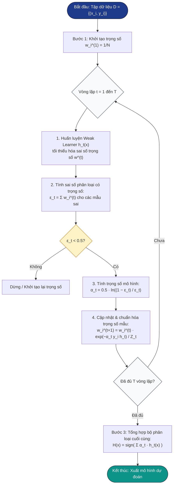

# Quy trình Thuật toán AdaBoost và Ví dụ Tính toán Minh họa

## 1. Quy trình Thuật toán AdaBoost (Adaptive Boosting)

### 1.1. Bối cảnh và Ý tưởng cốt lõi

Thuật toán **AdaBoost** (viết tắt của *Adaptive Boosting*), do **Yoav Freund và Robert Schapire** đề xuất năm 1995 (và hoàn thiện năm 1997), là một bước ngoặt lớn trong lịch sử Học máy (Machine Learning). Trước khi AdaBoost ra đời, câu hỏi lý thuyết của Kearns và Valiant (1988) vẫn còn bỏ ngỏ: *"Liệu một tập hợp các mô hình học yếu (weak learners — chỉ cần tốt hơn đoán ngẫu nhiên một chút) có thể kết hợp lại thành một mô hình học mạnh (strong learner — có độ chính xác tùy ý cao) hay không?"*. Freund và Schapire đã giải quyết trọn vẹn câu hỏi này bằng AdaBoost.

Khác với **Bagging** (huấn luyện song song, độc lập các mô hình trên các tập con dữ liệu ngẫu nhiên), AdaBoost hoạt động theo triết lý **huấn luyện tuần tự (sequential learning)**:

1. Các mô hình cơ sở (**Weak Learners** — thông thường là cây quyết định 1 tầng **Decision Stumps**) được huấn luyện nối tiếp nhau.
2. Mô hình sau luôn tập trung vào việc **sửa chữa sai lầm** của các mô hình đi trước.
3. Cơ chế thích nghi (*Adaptive*) được thực hiện thông qua **phân phối trọng số mẫu dữ liệu**:
   - Mẫu bị phân loại **sai** sẽ bị **phạt tăng trọng số**, khiến chúng trở nên quan trọng hơn và buộc mô hình kế tiếp phải ưu tiên xử lý.
   - Mẫu được phân loại **đúng** sẽ bị **giảm trọng số**, giảm mức độ ảnh hưởng trong các vòng sau.
4. Cuối cùng, các mô hình thành phần được kết hợp bằng quy tắc **biểu quyết đa số có trọng số (Weighted Majority Voting)**: mô hình nào có sai số thấp sẽ được gán trọng số độ tin cậy $\alpha$ cao, nắm giữ tiếng nói quyết định mạnh hơn trong toàn hệ thống.

---

### 1.2. Khung toán học và Các bước thực hiện chi tiết

#### Giả thiết bài toán
Cho tập dữ liệu huấn luyện gồm $N$ mẫu quan sát:

$$\mathcal{D} = \{(x_1, y_1), (x_2, y_2), \dots, (x_N, y_N)\}$$

Trong đó:
- $x_i \in \mathbb{R}^d$ là véc-tơ đặc trưng đầu vào ($d$ chiều).
- $y_i \in \{-1, +1\}$ là nhãn lớp phân loại nhị phân.
- $T$ là tổng số vòng lặp huấn luyện (tương ứng $T$ mô hình yếu).

---

#### Thuật toán chi tiết gồm 3 bước:

#### **Bước 1: Khởi tạo phân phối trọng số mẫu ban đầu**
Tại vòng lặp đầu tiên ($t = 1$), do chưa có thông tin về độ khó của các mẫu dữ liệu, trọng số được phân phối đều cho tất cả $N$ mẫu:

$$w_i^{(1)} = \frac{1}{N}, \quad \forall i = 1, 2, \dots, N$$

Tổng trọng số toàn tập luôn được bảo toàn bằng 1: $\sum_{i=1}^N w_i^{(1)} = 1$.

---

#### **Bước 2: Vòng lặp huấn luyện tuần tự (với mỗi $t = 1, 2, \dots, T$)**

Tại mỗi vòng lặp $t$:

**2.1. Huấn luyện mô hình yếu $h_t(x)$:**  
Huấn luyện một weak learner $h_t: \mathcal{X} \to \{-1, +1\}$ trên tập dữ liệu với phân phối trọng số $w^{(t)}$, sao cho tối thiểu hóa sai số phân loại có trọng số:

$$h_t = \arg\min_{h \in \mathcal{H}} \sum_{i: h(x_i) \neq y_i} w_i^{(t)}$$

**2.2. Tính sai số có trọng số $\epsilon_t$ (Weighted Error Rate):**  
Tổng trọng số của các mẫu mà $h_t$ dự đoán sai:

$$\epsilon_t = \sum_{i=1}^N w_i^{(t)} \cdot \mathbb{I}(h_t(x_i) \neq y_i) = \sum_{h_t(x_i) \neq y_i} w_i^{(t)}$$

Trong đó $\mathbb{I}(\cdot)$ là hàm chỉ thị (bằng 1 nếu điều kiện đúng, ngược lại bằng 0).  
*Điều kiện lý thuyết bắt buộc:* Mô hình yếu phải tốt hơn đoán ngẫu nhiên, tức $\epsilon_t < 0.5$. Nếu $\epsilon_t \ge 0.5$, quá trình dừng lại hoặc đảo ngược nhãn dự đoán.

**2.3. Tính trọng số tin cậy của mô hình $\alpha_t$ (Model Weight / Amount of Say):**

$$\alpha_t = \frac{1}{2} \ln \left( \frac{1 - \epsilon_t}{\epsilon_t} \right)$$

*Phân tích ý nghĩa toán học của $\alpha_t$:*
- Khi $\epsilon_t \to 0$ (mô hình dự đoán gần như hoàn hảo) $\implies \frac{1 - \epsilon_t}{\epsilon_t} \to +\infty \implies \alpha_t \to +\infty$ (tiếng nói cực lớn).
- Khi $\epsilon_t = 0.5$ (ngang ngửa đoán ngẫu nhiên) $\implies \frac{1 - \epsilon_t}{\epsilon_t} = 1 \implies \alpha_t = 0$ (mô hình không có đóng góp gì vào quyết định cuối cùng).
- Khi $\epsilon_t \to 0.5^-$ (sai số xấp xỉ 50%) $\implies \alpha_t$ tiến dần về 0 từ phía dương.

**2.4. Cập nhật và chuẩn hóa trọng số mẫu cho vòng tiếp theo ($w_i^{(t+1)}$):**

$$w_i^{(t+1)} = \frac{w_i^{(t)} \cdot \exp\left( -\alpha_t y_i h_t(x_i) \right)}{Z_t}$$

Trong đó:
- Đại lượng $y_i h_t(x_i)$ thể hiện tính đúng/sai của dự đoán:
  - Nếu dự đoán **đúng** ($h_t(x_i) = y_i$) $\implies y_i h_t(x_i) = +1 \implies \text{nhân với } \exp(-\alpha_t) < 1 \implies$ **Trọng số mẫu giảm**.
  - Nếu dự đoán **sai** ($h_t(x_i) \neq y_i$) $\implies y_i h_t(x_i) = -1 \implies \text{nhân với } \exp(+\alpha_t) > 1 \implies$ **Trọng số mẫu tăng vọt**.
- $Z_t$ là hằng số chuẩn hóa (Normalization Factor) nhằm đảm bảo $\sum_{i=1}^N w_i^{(t+1)} = 1$:

$$Z_t = \sum_{i=1}^N w_i^{(t)} \cdot \exp\left( -\alpha_t y_i h_t(x_i) \right) = 2\sqrt{\epsilon_t(1 - \epsilon_t)}$$

---

#### **Bước 3: Tổng hợp mô hình Ensemble cuối cùng**
Sau khi hoàn thành $T$ vòng lặp, mô hình mạnh cuối cùng $H(x)$ đưa ra dự đoán bằng cách lấy dấu của tổng tuyến tính có trọng số từ tất cả $T$ mô hình yếu:

$$H(x) = \text{sign}\left( \sum_{t=1}^T \alpha_t h_t(x) \right)$$

Quy tắc phân loại:
- Nếu $\sum_{t=1}^T \alpha_t h_t(x) > 0 \implies H(x) = +1$.
- Nếu $\sum_{t=1}^T \alpha_t h_t(x) < 0 \implies H(x) = -1$.

---

### 1.3. Mã giả thuật toán (Pseudocode) và Sơ đồ khối (Flowchart)

```text
Algorithm: AdaBoost (Adaptive Boosting)
Input: 
    - Training dataset D = {(x_1, y_1), ..., (x_N, y_N)}, with y_i in {-1, +1}
    - Base learning algorithm (e.g., Decision Stump)
    - Number of iterations T
Output: 
    - Final Strong Classifier H(x)

1. Initialize sample weights: w_i^(1) = 1 / N for all i = 1, ..., N.
2. For t = 1 to T do:
    a. Train weak learner h_t(x) using weight distribution w^(t).
    b. Compute weighted error: 
           epsilon_t = sum_{i: h_t(x_i) != y_i} w_i^(t)
    c. If epsilon_t >= 0.5:
           Break or re-initialize weights.
    d. Compute model weight (say): 
           alpha_t = 0.5 * ln((1 - epsilon_t) / epsilon_t)
    e. Compute normalization factor: 
           Z_t = 2 * sqrt(epsilon_t * (1 - epsilon_t))
    f. Update sample weights for next round:
           w_i^(t+1) = (w_i^(t) * exp(-alpha_t * y_i * h_t(x_i))) / Z_t
3. Return final classifier:
       H(x) = sign( sum_{t=1}^T alpha_t * h_t(x) )
```

#### Sơ đồ khối quy trình (Flowchart):



---

### 1.4. Phân tích hàm mất mát hàm mũ (Exponential Loss) và Cơ chế hội tụ

Bản chất toán học sâu xa của AdaBoost là một thuật toán **tối ưu hóa hàm cộng tính từng bước (Forward Stagewise Additive Modeling)** nhằm tối thiểu hóa **hàm mất mát hàm mũ (Exponential Loss)**:

$$\mathcal{L}_{\text{exp}}(y, f(x)) = \exp\left( -y \cdot f(x) \right)$$

Trong đó $f(x) = \sum_{t=1}^T \alpha_t h_t(x)$ là hàm dự đoán tích lũy.

#### Ý nghĩa lý thuyết:
1. **Chặn trên sai số huấn luyện:** Sai số phân loại 0-1 trên tập huấn luyện $\frac{1}{N} \sum_{i=1}^N \mathbb{I}(H(x_i) \neq y_i)$ luôn bị chặn trên bởi trung bình hàm mất mát hàm mũ:
   
   $$\mathbb{I}(H(x_i) \neq y_i) \le \exp\left( -y_i f(x_i) \right)$$

2. **Công thức tích lũy của thừa số chuẩn hóa:**
   
   $$\frac{1}{N} \sum_{i=1}^N \exp\left( -y_i f(x_i) \right) = \prod_{t=1}^T Z_t = \prod_{t=1}^T 2\sqrt{\epsilon_t(1 - \epsilon_t)}$$

3. **Tốc độ hội tụ theo hàm mũ:** Đặt $\gamma_t = 0.5 - \epsilon_t > 0$ là biên lợi thế (edge) của mô hình yếu so với đoán ngẫu nhiên:
   
   $$Z_t = 2\sqrt{\left(\frac{1}{2} - \gamma_t\right)\left(\frac{1}{2} + \gamma_t\right)} = \sqrt{1 - 4\gamma_t^2} \le \exp(-2\gamma_t^2)$$
   
   Do đó, sai số huấn luyện của AdaBoost giảm theo hàm mũ sau mỗi vòng lặp:
   
   $$\text{Training Error} \le \exp\left( -2 \sum_{t=1}^T \gamma_t^2 \right)$$
   
   Chỉ cần mỗi mô hình yếu duy trì được một lợi thế nhỏ $\gamma_t \ge \gamma > 0$, sai số trên tập huấn luyện sẽ **tiến về 0 rất nhanh chóng** khi tăng số vòng lặp $T$.

---

## 2. Ví dụ Tính toán Số học Minh họa Chi tiết

Để minh chứng chính xác và tường minh từng phép tính số học của AdaBoost mà không bỏ sót bất kỳ bước trung gian nào, ta xây dựng một tập dữ liệu mẫu (Toy Dataset) 1 chiều gồm 8 mẫu lâm sàng và giải tay chi tiết qua 3 vòng lặp.

### 2.1. Xây dựng tập dữ liệu mẫu (Toy Dataset)

- **Đặc trưng đầu vào $X$:** Thang điểm chỉ số lâm sàng (từ 1 đến 8).
- **Nhãn lớp $y \in \{-1, +1\}$:** $+1$ đại diện cho nhóm Nguy cơ cao, $-1$ đại diện cho nhóm Nguy cơ thấp.
- **Trọng số khởi tạo đồng đều ($t = 1$):** $w_i^{(1)} = \frac{1}{8} = 0.1250$ với mọi $i$.

| Mẫu ($i$) | Đặc trưng ($X_i$) | Nhãn thực tế ($y_i$) | Trọng số khởi tạo ($w_i^{(1)}$) |
| :---: | :---: | :---: | :---: |
| 1 | 1.0 | **-1** | 0.1250 (1/8) |
| 2 | 2.0 | **-1** | 0.1250 (1/8) |
| 3 | 3.0 | **+1** | 0.1250 (1/8) |
| 4 | 4.0 | **+1** | 0.1250 (1/8) |
| 5 | 5.0 | **+1** | 0.1250 (1/8) |
| 6 | 6.0 | **-1** | 0.1250 (1/8) |
| 7 | 7.0 | **-1** | 0.1250 (1/8) |
| 8 | 8.0 | **+1** | 0.1250 (1/8) |

*Nhận xét về dữ liệu:* Dữ liệu có tính phi tuyến cục bộ ở vị trí $X = 6, 7$ (bị kẹp giữa các mẫu $+1$), do đó một cây quyết định 1 tầng đơn lẻ (Decision Stump) không thể phân tách hoàn hảo toàn bộ tập dữ liệu.

---

### 2.2. Chi tiết tính toán Vòng lặp 1 ($t = 1$)

#### 1. Huấn luyện Decision Stump 1 ($h_1$):
Xét tất cả các điểm chia khả dĩ, ngưỡng phân chia tối ưu là $X = 2.5$:

$$h_1(x) = \begin{cases} +1 & \text{nếu } X > 2.5 \\ -1 & \text{nếu } X \le 2.5 \end{cases}$$

Kết quả dự đoán của $h_1$ trên 8 mẫu:
- $X \in \{1, 2\} \le 2.5 \implies h_1 = -1$ (đúng với nhãn thật).
- $X \in \{3, 4, 5\} > 2.5 \implies h_1 = +1$ (đúng với nhãn thật).
- $X \in \{6, 7\} > 2.5 \implies h_1 = +1$ (nhãn thật là $-1 \implies$ **DỰ ĐOÁN SAI**).
- $X = 8 > 2.5 \implies h_1 = +1$ (đúng với nhãn thật).

Như vậy, $h_1$ đoán sai 2 mẫu: **Mẫu 6 và Mẫu 7**.

#### 2. Tính sai số có trọng số $\epsilon_1$:

$$\epsilon_1 = w_6^{(1)} + w_7^{(1)} = \frac{1}{8} + \frac{1}{8} = \frac{2}{8} = 0.2500$$

Do $\epsilon_1 = 0.25 < 0.5$, mô hình đạt chuẩn yêu cầu.

#### 3. Tính trọng số mô hình $\alpha_1$:

$$\alpha_1 = \frac{1}{2} \ln \left( \frac{1 - 0.25}{0.25} \right) = \frac{1}{2} \ln(3) \approx \frac{1}{2} \times 1.098612 \approx \mathbf{0.549306}$$

#### 4. Cập nhật phân phối trọng số mẫu sang Vòng 2 ($w^{(2)}$):
- Nhân tử điều chỉnh:
  - Mẫu đoán đúng ($i \in \{1, 2, 3, 4, 5, 8\}$): $\exp(-\alpha_1) = \exp(-0.549306) = \frac{1}{\sqrt{3}} \approx 0.577350$.
  - Mẫu đoán sai ($i \in \{6, 7\}$): $\exp(+\alpha_1) = \exp(0.549306) = \sqrt{3} \approx 1.732051$.
- Trọng số chưa chuẩn hóa:
  - Mẫu đúng: $w_i^{(1)} \cdot \exp(-\alpha_1) = \frac{1}{8} \times \frac{1}{\sqrt{3}} \approx 0.072169$.
  - Mẫu sai: $w_i^{(1)} \cdot \exp(+\alpha_1) = \frac{1}{8} \times \sqrt{3} \approx 0.216506$.
- Thừa số chuẩn hóa $Z_1$:

$$Z_1 = 6 \times \left(\frac{1}{8\sqrt{3}}\right) + 2 \times \left(\frac{\sqrt{3}}{8}\right) = \frac{\sqrt{3}}{4} + \frac{\sqrt{3}}{4} = \frac{\sqrt{3}}{2} \approx \mathbf{0.866025}$$
*(Khớp chính xác với công thức lý thuyết: $Z_1 = 2\sqrt{0.25 \times 0.75} = \frac{\sqrt{3}}{2}$)*.

- Trọng số chuẩn hóa $w_i^{(2)} = \frac{\text{trọng số chưa chuẩn hóa}}{Z_1}$:
  - Mẫu đúng ($i = 1, 2, 3, 4, 5, 8$):
    $$w_i^{(2)} = \frac{\frac{1}{8\sqrt{3}}}{\frac{\sqrt{3}}{2}} = \frac{1}{8\sqrt{3}} \times \frac{2}{\sqrt{3}} = \frac{2}{24} = \frac{\mathbf{1}}{\mathbf{12}} \approx \mathbf{0.083333}$$
  - Mẫu sai ($i = 6, 7$):
    $$w_i^{(2)} = \frac{\frac{\sqrt{3}}{8}}{\frac{\sqrt{3}}{2}} = \frac{\sqrt{3}}{8} \times \frac{2}{\sqrt{3}} = \frac{2}{8} = \frac{\mathbf{1}}{\mathbf{4}} = \mathbf{0.250000}$$

*Ý nghĩa then chốt:* Hai mẫu bị đoán sai (Mẫu 6 và 7) đã bị phạt tăng trọng số gấp đôi từ $0.1250 \to 0.2500$, chiếm tổng cộng **50% trọng số toàn tập** ở vòng tiếp theo!

---

### 2.3. Chi tiết tính toán Vòng lặp 2 ($t = 2$)

#### 1. Huấn luyện Decision Stump 2 ($h_2$):
Dưới áp lực 50% trọng số của mẫu 6 và 7, thuật toán buộc phải chọn ngưỡng để phân loại đúng 2 mẫu này. Điểm cắt tối ưu là $X = 5.5$ với chiều bất đẳng thức đảo:

$$h_2(x) = \begin{cases} +1 & \text{nếu } X \le 5.5 \\ -1 & \text{nếu } X > 5.5 \end{cases}$$

Kết quả dự đoán của $h_2$:
- $X \in \{1, 2\} \le 5.5 \implies h_2 = +1$ (nhãn thật $-1 \implies$ **SAI**).
- $X \in \{3, 4, 5\} \le 5.5 \implies h_2 = +1$ (đúng với nhãn thật).
- $X \in \{6, 7\} > 5.5 \implies h_2 = -1$ (nhãn thật $-1 \implies$ **ĐÃ ĐƯỢC SỬA ĐÚNG HOÀN TOÀN!**).
- $X = 8 > 5.5 \implies h_2 = -1$ (nhãn thật $+1 \implies$ **SAI**).

Mẫu bị sai mới: **Mẫu 1, Mẫu 2 và Mẫu 8**.

#### 2. Tính sai số có trọng số $\epsilon_2$:

$$\epsilon_2 = w_1^{(2)} + w_2^{(2)} + w_8^{(2)} = \frac{1}{12} + \frac{1}{12} + \frac{1}{12} = \frac{3}{12} = \frac{1}{4} = \mathbf{0.2500}$$

#### 3. Tính trọng số mô hình $\alpha_2$:

$$\alpha_2 = \frac{1}{2} \ln \left( \frac{1 - 0.25}{0.25} \right) = \frac{1}{2} \ln(3) \approx \mathbf{0.549306}$$

#### 4. Cập nhật phân phối trọng số mẫu sang Vòng 3 ($w^{(3)}$):
- Thừa số chuẩn hóa: $Z_2 = 2\sqrt{0.25 \times 0.75} = \frac{\sqrt{3}}{2} \approx 0.866025$.
- Trọng số chuẩn hóa $w_i^{(3)}$:
  - Nhóm 3 mẫu đúng cả 2 vòng ($i \in \{3, 4, 5\}$):
    $$w_i^{(3)} = \frac{w_i^{(2)} \cdot \exp(-\alpha_2)}{Z_2} = \frac{\frac{1}{12} \times \frac{1}{\sqrt{3}}}{\frac{\sqrt{3}}{2}} = \frac{\mathbf{1}}{\mathbf{18}} \approx \mathbf{0.055556}$$
  - Nhóm 5 mẫu đúng 1 vòng và sai 1 vòng ($i \in \{1, 2, 6, 7, 8\}$):
    $$w_i^{(3)} = \frac{\mathbf{1}}{\mathbf{6}} \approx \mathbf{0.166667}$$
- Kiểm tra bảo toàn tổng: $3 \times \frac{1}{18} + 5 \times \frac{1}{6} = \frac{1}{6} + \frac{5}{6} = 1.0000$.

---

### 2.4. Chi tiết tính toán Vòng lặp 3 ($t = 3$)

#### 1. Huấn luyện Decision Stump 3 ($h_3$):
Tại vòng 3, mục tiêu là phân tách mẫu 8 ($X = 8, y = +1, w = 1/6$) ở biên phải mà không làm hỏng các mẫu đã phân loại tốt. Ngưỡng cắt tối ưu là $X = 7.5$:

$$h_3(x) = \begin{cases} +1 & \text{nếu } X > 7.5 \\ -1 & \text{nếu } X \le 7.5 \end{cases}$$

Kết quả dự đoán của $h_3$:
- $X \in \{1, 2\} \le 7.5 \implies h_3 = -1$ (đúng với nhãn thật).
- $X \in \{3, 4, 5\} \le 7.5 \implies h_3 = -1$ (nhãn thật $+1 \implies$ **SAI**).
- $X \in \{6, 7\} \le 7.5 \implies h_3 = -1$ (đúng với nhãn thật).
- $X = 8 > 7.5 \implies h_3 = +1$ (nhãn thật $+1 \implies$ **ĐÃ ĐƯỢC SỬA ĐÚNG!**).

Mẫu bị sai: **Mẫu 3, Mẫu 4 và Mẫu 5**.

#### 2. Tính sai số có trọng số $\epsilon_3$:

$$\epsilon_3 = w_3^{(3)} + w_4^{(3)} + w_5^{(3)} = \frac{1}{18} + \frac{1}{18} + \frac{1}{18} = \frac{3}{18} = \frac{\mathbf{1}}{\mathbf{6}} \approx \mathbf{0.166667}$$

#### 3. Tính trọng số mô hình $\alpha_3$:

$$\alpha_3 = \frac{1}{2} \ln \left( \frac{1 - 1/6}{1/6} \right) = \frac{1}{2} \ln(5) \approx \frac{1}{2} \times 1.609438 \approx \mathbf{0.804719}$$

Do $\epsilon_3 = 0.1667 < \epsilon_1 = \epsilon_2 = 0.2500$, mô hình $h_3$ có độ tin cậy cao nhất và nhận được trọng số $\alpha_3 = 0.8047$ lớn nhất trong 3 mô hình!

---

### 2.5. Bảng tổng hợp đối soát hội tụ 100% qua 3 vòng lặp

Phương trình biểu quyết có trọng số tổng hợp:

$$F(x) = \sum_{t=1}^3 \alpha_t h_t(x) = 0.5493 \cdot h_1(x) + 0.5493 \cdot h_2(x) + 0.8047 \cdot h_3(x)$$

Dự đoán phân loại cuối cùng: $H(x) = \text{sign}(F(x))$.

| $i$ | $X_i$ | Nhãn $y_i$ | $h_1(x_i)$ | $h_2(x_i)$ | $h_3(x_i)$ | Tính điểm tích lũy $F(x_i)$ | Giá trị $F(x_i)$ | Dự đoán $H(x_i)$ | Đánh giá |
| :---: | :---: | :---: | :---: | :---: | :---: | :--- | :---: | :---: | :---: |
| 1 | 1.0 | **-1** | -1 | +1 | -1 | $-0.5493 + 0.5493 - 0.8047$ | **-0.8047** | **-1** | **ĐÚNG** |
| 2 | 2.0 | **-1** | -1 | +1 | -1 | $-0.5493 + 0.5493 - 0.8047$ | **-0.8047** | **-1** | **ĐÚNG** |
| 3 | 3.0 | **+1** | +1 | +1 | -1 | $+0.5493 + 0.5493 - 0.8047$ | **+0.2939** | **+1** | **ĐÚNG** |
| 4 | 4.0 | **+1** | +1 | +1 | -1 | $+0.5493 + 0.5493 - 0.8047$ | **+0.2939** | **+1** | **ĐÚNG** |
| 5 | 5.0 | **+1** | +1 | +1 | -1 | $+0.5493 + 0.5493 - 0.8047$ | **+0.2939** | **+1** | **ĐÚNG** |
| 6 | 6.0 | **-1** | +1 | -1 | -1 | $+0.5493 - 0.5493 - 0.8047$ | **-0.8047** | **-1** | **ĐÚNG** |
| 7 | 7.0 | **-1** | +1 | -1 | -1 | $+0.5493 - 0.5493 - 0.8047$ | **-0.8047** | **-1** | **ĐÚNG** |
| 8 | 8.0 | **+1** | +1 | -1 | +1 | $+0.5493 - 0.5493 + 0.8047$ | **+0.8047** | **+1** | **ĐÚNG** |

#### Kết luận định lượng:
- **Tỷ lệ chính xác (Accuracy):** Đạt **8/8 mẫu = 100.0%**.
- Dù mỗi Decision Stump đơn lẻ chỉ đạt độ chính xác $75.0\%$ (Stump 1 sai 2/8, Stump 2 sai 3/8, Stump 3 sai 3/8), sự kết hợp có trọng số qua cơ chế thích nghi của AdaBoost đã **triệt tiêu hoàn toàn sai số**, đưa độ chính xác của hệ thống Ensemble lên mức tuyệt đối $100\%$.

---

## 3. Nhận xét Học thuật & So sánh Đặc tính

### 3.1. Cơ chế tối đa hóa lề (Margin Maximization)
Một hiện tượng đáng chú ý của AdaBoost được Schapire et al. (1998) phát hiện là: **AdaBoost tiếp tục cải thiện khả năng tổng quát hóa (Generalization) ngay cả khi sai số huấn luyện đã chạm mức 0**.

Hiện tượng này được giải thích thông qua khái niệm **lề phân loại (Classification Margin)**:

$$\text{Margin}(x, y) = y \cdot \frac{\sum_{t=1}^T \alpha_t h_t(x)}{\sum_{t=1}^T \alpha_t}$$

- Lề đo lường mức độ tự tin của quyết định phân loại: $\text{Margin} \in [-1, +1]$.
- Giá trị dương thể hiện phân loại đúng; độ lớn càng gần $+1$ thể hiện sự đồng thuận áp đảo giữa các mô hình yếu.
- Khi tiếp tục chạy thêm các vòng lặp sau khi sai số đã bằng 0, AdaBoost không làm giảm sai số huấn luyện nữa mà **làm tăng khoảng cách lề của các điểm dữ liệu khó**, từ đó giúp mô hình kháng cự tốt hơn với phương sai (variance) trên tập kiểm thử.

---

### 3.2. Tính nhạy cảm với nhiễu và ngoại lai (Noise Sensitivity)
Mặc dù rất mạnh mẽ trên dữ liệu sạch, AdaBoost có một nhược điểm cố hữu xuất phát từ hàm mất mát hàm mũ $\exp(-y f(x))$:
- Hàm mũ tăng trưởng cực nhanh khi gặp sai số lớn ($y f(x) \ll 0$).
- Nếu tập dữ liệu có **nhãn bị gán sai (label noise)** hoặc **giá trị ngoại lai (outliers)**, AdaBoost sẽ liên tục nhân trọng số của những điểm nhiễu này lên theo cấp số nhân qua từng vòng lặp.
- Hậu quả: Các mô hình yếu ở những vòng sau sẽ bị "bắt cóc" (hijacked) để cố gắng khớp những điểm nhiễu không thể phân loại, dẫn đến hiện tượng **Overfitting nghiêm trọng**.
- *Giải pháp khắc phục:* Trong thực tế, các biến thể như **LogitBoost** (dùng logistic loss) hoặc **Gradient Boosting với Huber Loss** thường được ưu tiên khi dữ liệu có nhiều nhiễu.

---

### 3.3. So sánh quy trình thực hiện giữa các thuật toán Ensemble

| Tiêu chí | Bagging (Random Forest) | Boosting (AdaBoost) | Gradient Boosting (GBM / XGBoost) |
| :--- | :--- | :--- | :--- |
| **Quy trình huấn luyện** | **Song song, độc lập** | **Tuần tự (Sequential)** | **Tuần tự (Sequential)** |
| **Cơ chế mô hình sau** | Độc lập, không biết mô hình trước | Tập trung vào **mẫu bị đoán sai** (tăng trọng số mẫu) | Tập trung vào **phần dư / gradient âm** của hàm mất mát |
| **Base Learner lý tưởng** | Cây quyết định sâu (Low bias, high variance) | Cây quyết định rất nông (High bias, low variance) | Cây quyết định nông/vừa (độ sâu 3 - 6) |
| **Cơ chế tổng hợp** | Bỏ phiếu đa số bình đẳng (Simple Majority Vote) | **Biểu quyết có trọng số** theo $\alpha_t$ | **Cộng dồn liên tục** các hàm xấp xỉ phần dư |
| **Mục tiêu tối ưu chính** | Giảm mạnh **Phương sai (Variance)** | Giảm mạnh **Độ chệch (Bias)** | Giảm mạnh cả **Bias và Variance** |
| **Độ nhạy với nhiễu** | Rất bền vững, chống nhiễu tốt | **Rất nhạy cảm** với nhiễu và outlier | Trung bình (kiểm soát qua learning rate và regularization) |

---

## Tài liệu tham khảo

1. Freund, Y., & Schapire, R. E. (1995). A decision-theoretic generalization of on-line learning and an application to boosting. *European Conference on Computational Learning Theory* (pp. 23-37). Springer, Berlin, Heidelberg.
2. Freund, Y., & Schapire, R. E. (1997). A decision-theoretic generalization of on-line learning and an application to boosting. *Journal of Computer and System Sciences*, 55(1), 119-139.
3. Schapire, R. E., Freund, Y., Bartlett, P., & Lee, W. S. (1998). Boosting the margin: A new explanation for the effectiveness of voting methods. *The Annals of Statistics*, 26(5), 1651-1686.
4. Schapire, R. E., & Freund, Y. (2012). *Boosting: Foundations and Algorithms*. MIT Press.
5. Hastie, T., Tibshirani, R., & Friedman, J. (2009). *The Elements of Statistical Learning: Data Mining, Inference, and Prediction* (2nd ed.). Springer Series in Statistics.
6. Dietterich, T. G. (2000). Ensemble methods in machine learning. *International Workshop on Multiple Classifier Systems* (pp. 1-15). Springer, Berlin, Heidelberg.
