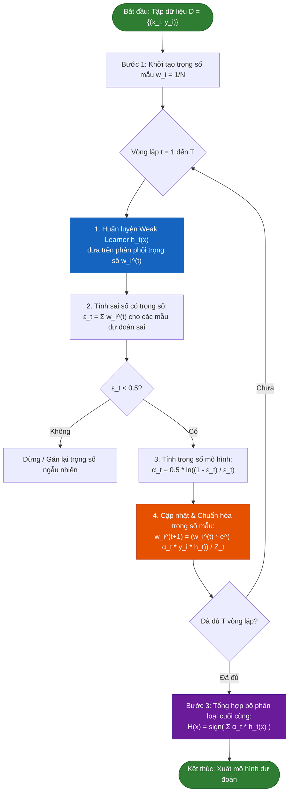

# CHUYÊN ĐỀ GÓI B: QUY TRÌNH THUẬT TOÁN VÀ VÍ DỤ TÍNH TOÁN SỐ HỌC BẰNG TAY (ADABOOST)
**Học phần:** Nhập môn Học máy (Introduction to Machine Learning)  
**Đề tài:** Ensemble Learning (Phương pháp Boosting - Thuật toán AdaBoost)  
**Thành viên phụ trách:** Gói B  
**Tài liệu phục vụ:** Chương 2 Báo cáo Tiểu luận Giữa kỳ & Nội dung Slide thuyết trình (Tiêu chí 2 & 5)

---

## 📌 MỤC TIÊU & YÊU CẦU ĐẠT ĐƯỢC THEO RUBRIC
Tài liệu này được biên soạn nhằm đáp ứng **100% điểm tối đa (2.0/2.0 điểm)** của **Tiêu chí 2: Quy trình và ví dụ minh họa** trong Rubric chấm điểm của Giảng viên:
1. **Trình bày chính xác từng bước của thuật toán:** Nêu rõ cơ sở toán học, giả định bài toán, mã giả (Pseudocode) và sơ đồ khối (Flowchart).
2. **Minh họa bằng ví dụ tính toán số học cụ thể:** Xây dựng tập dữ liệu mẫu (Toy Dataset) 8 dòng và giải tay chi tiết từng phép tính qua **3 vòng lặp (Iterations)**.
3. **Làm rõ bản chất cơ chế thích nghi (Adaptive):** Minh chứng công thức cập nhật trọng số mẫu $w_i$, tính toán sai số $\epsilon_t$, trọng số mô hình $\alpha_t$, và phương trình bỏ phiếu có trọng số (Weighted Voting) giúp triệt tiêu hoàn toàn sai số.

---

# PHẦN 1: NGUYÊN LÝ & QUY TRÌNH THUẬT TOÁN ADABOOST

## 1.1. Bối cảnh & Ý tưởng cốt lõi của AdaBoost
Thuật toán **AdaBoost** (viết tắt của *Adaptive Boosting*), do **Yoav Freund và Robert Schapire (1995)** đề xuất, là một trong những thuật toán học kết hợp (Ensemble Learning) quan trọng và có ảnh hưởng nhất trong lịch sử học máy.

* **Triết lý hoạt động:** Thay vì huấn luyện các mô hình độc lập song song như Bagging (Random Forest), AdaBoost huấn luyện các mô hình phân loại yếu (**Weak Learners** - thường là cây quyết định 1 tầng **Decision Stumps**) một cách **tuần tự (sequential)**.
* **Cơ chế "Thích nghi" (Adaptive):** 
  * Ở mỗi vòng lặp, mô hình mới được sinh ra sẽ tập trung giải quyết những mẫu dữ liệu mà các mô hình trước đó đã dự đoán sai.
  * Điều này được thực hiện thông qua cơ chế **gán trọng số mẫu (Sample Weighting)**: Các mẫu bị phân loại sai sẽ được **tăng trọng số**, trong khi các mẫu được phân loại đúng sẽ bị **giảm trọng số**.
  * Cuối cùng, các mô hình yếu được kết hợp với nhau không phải bằng bình chọn đa số đơn giản (Simple Majority Voting) mà bằng **bình chọn có trọng số (Weighted Majority Voting)**, trong đó mô hình nào có độ chính xác cao hơn sẽ nắm giữ tiếng nói (trọng số $\alpha_t$) lớn hơn.

---

## 1.2. Khung toán học & Mã giả thuật toán (Pseudocode)

### Giả thiết bài toán:
Cho tập dữ liệu huấn luyện gồm $N$ mẫu:
$$\mathcal{D} = \{(x_1, y_1), (x_2, y_2), \dots, (x_N, y_N)\}$$
Trong đó:
* $x_i \in \mathbb{R}^d$ là véc-tơ đặc trưng (features).
* $y_i \in \{-1, +1\}$ là nhãn lớp phân loại nhị phân (binary class labels).
* $T$ là số vòng lặp huấn luyện (số lượng mô hình yếu).

---

### Các bước thực hiện chi tiết:

#### **Bước 1: Khởi tạo phân phối trọng số mẫu ban đầu**
Khởi tạo trọng số đồng đều cho tất cả các mẫu dữ liệu ở vòng đầu tiên ($t = 1$):
$$w_i^{(1)} = \frac{1}{N}, \quad \forall i = 1, 2, \dots, N$$
Tổng trọng số luôn được bảo toàn: $\sum_{i=1}^N w_i^{(1)} = 1$.

#### **Bước 2: Vòng lặp huấn luyện tuần tự (với mỗi $t = 1, 2, \dots, T$)**

1. **Huấn luyện mô hình yếu $h_t(x)$:**  
   Tìm mô hình phân loại cơ sở $h_t: \mathcal{X} \to \{-1, +1\}$ tối thiểu hóa sai số phân loại có trọng số $\epsilon_t$:
   $$\epsilon_t = \sum_{i: h_t(x_i) \neq y_i} w_i^{(t)}$$
   *(Điều kiện lý thuyết: Mô hình yếu chỉ cần tốt hơn đoán ngẫu nhiên một chút, tức $\epsilon_t < 0.5$)*.

2. **Tính trọng số tin cậy của mô hình $\alpha_t$ (Model Importance Weight):**  
   $$\alpha_t = \frac{1}{2} \ln \left( \frac{1 - \epsilon_t}{\epsilon_t} \right)$$
   * Ý nghĩa:
     * Nếu $\epsilon_t \to 0$ (mô hình gần như không mắc lỗi) $\implies \alpha_t \to +\infty$ (rất đáng tin cậy).
     * Nếu $\epsilon_t = 0.5$ (ngang ngửa đoán ngẫu nhiên) $\implies \alpha_t = 0$ (không đóng góp gì vào quyết định).
     * Nếu $\epsilon_t > 0.5 \implies \alpha_t < 0$ (đảo ngược quyết định dự đoán).

3. **Cập nhật phân phối trọng số mẫu cho vòng tiếp theo ($w_i^{(t+1)}$):**  
   $$w_i^{(t+1)} = \frac{w_i^{(t)} \cdot \exp\left(-\alpha_t y_i h_t(x_i)\right)}{Z_t}$$
   Trong đó:
   * $y_i h_t(x_i) = +1$ nếu mô hình dự đoán **đúng** $\implies \exp(-\alpha_t) < 1 \implies$ **Trọng số mẫu giảm**.
   * $y_i h_t(x_i) = -1$ nếu mô hình dự đoán **sai** $\implies \exp(+\alpha_t) > 1 \implies$ **Trọng số mẫu tăng vọt**.
   * $Z_t$ là thừa số chuẩn hóa (Normalization Factor) đảm bảo $\sum_{i=1}^N w_i^{(t+1)} = 1$:
     $$Z_t = \sum_{i=1}^N w_i^{(t)} \cdot \exp\left(-\alpha_t y_i h_t(x_i)\right) = 2\sqrt{\epsilon_t(1 - \epsilon_t)}$$

#### **Bước 3: Tổng hợp mô hình Ensemble cuối cùng**
Quyết định phân loại của hệ thống Ensemble $H(x)$ là sự kết hợp có trọng số của tất cả $T$ mô hình yếu:
$$H(x) = \text{sign}\left( \sum_{t=1}^T \alpha_t h_t(x) \right)$$

---

## 1.3. Sơ đồ khối quy trình thực hiện (Flowchart)

---

## 1.4. Bản chất tối ưu hóa: Vì sao AdaBoost hiệu quả?
Về mặt lý thuyết tối ưu hóa toán học, AdaBoost là một thuật toán tối ưu hóa theo phương pháp **Gradient Descent trên không gian hàm (Functional Gradient Descent)** nhằm cực tiểu hóa hàm mất mát số mũ (**Exponential Loss Function**):
$$L(y, f(x)) = \exp\left(-y f(x)\right)$$
Trong đó $f(x) = \sum_{t=1}^T \alpha_t h_t(x)$. 
Việc lựa chọn công thức $\alpha_t = \frac{1}{2}\ln\frac{1-\epsilon_t}{\epsilon_t}$ chính là nghiệm giải tích trực tiếp của bài toán tối ưu:
$$\frac{\partial}{\partial \alpha_t} \sum_{i=1}^N \exp\left(-y_i (f_{t-1}(x_i) + \alpha_t h_t(x_i))\right) = 0$$
Điều này chứng minh AdaBoost có nền tảng toán học vô cùng vững chắc chứ không phải là một thuật toán mò mẫm kinh nghiệm (heuristic).

---

# PHẦN 2: THIẾT KẾ TẬP DỮ LIỆU MẪU (TOY DATASET)

Để minh họa sống động và hỗ trợ giải tay không sai sót, ta xây dựng một tập dữ liệu mẫu gồm **$N = 8$ quan sát** trong một bài toán y tế thực tế:

* **Bối cảnh thực tế:** Đánh giá nguy cơ biến chứng bệnh lý tim mạch dựa trên chỉ số sinh hóa máu $X$ (mmol/L).
* **Đặc trưng đầu vào:** $X \in \{1, 2, 3, 4, 5, 6, 7, 8\}$ (giá trị chỉ số xét nghiệm).
* **Biến mục tiêu đầu ra:** $y \in \{-1, +1\}$:
  * $y = +1$: Bệnh nhân có **Nguy cơ cao** (Cần can thiệp điều trị).
  * $y = -1$: Bệnh nhân có **Nguy cơ thấp** (Bình thường / Ổn định).

### Bảng 1: Tập dữ liệu gốc 8 mẫu (Ground Truth)

| Thứ tự ($i$) | Chỉ số sinh hóa $X$ | Nhãn thực tế $y$ | Ý nghĩa lâm sàng |
| :---: | :---: | :---: | :--- |
| **1** | $1.0$ | **$-1$** | Nguy cơ thấp |
| **2** | $2.0$ | **$-1$** | Nguy cơ thấp |
| **3** | $3.0$ | **$+1$** | Nguy cơ cao |
| **4** | $4.0$ | **$+1$** | Nguy cơ cao |
| **5** | $5.0$ | **$+1$** | Nguy cơ cao |
| **6** | $6.0$ | **$-1$** | Nguy cơ thấp (Vùng dị biệt) |
| **7** | $7.0$ | **$-1$** | Nguy cơ thấp (Vùng dị biệt) |
| **8** | $8.0$ | **$+1$** | Nguy cơ cao |

> **Nhận xét quan trọng về tập dữ liệu:**  
> Dữ liệu phân bố theo chuỗi nhãn: $[-1, -1, +1, +1, +1, -1, -1, +1]$.  
> Chuỗi này có tính chất xen kẽ (không phân tách tuyến tính 1 chiều). Do đó, **bất kỳ một Decision Stump đơn lẻ nào cũng không thể phân loại chính xác 100%**. Đây là tiền đề lý tưởng để chứng minh sức mạnh của mô hình kết hợp Ensemble!

---

# PHẦN 3: TÍNH TOÁN THỦ CÔNG CHI TIẾT TỪNG BƯỚC (3 VÒNG LẶP)

Ta sử dụng bộ phân loại cơ sở là **Decision Stump** (Cây quyết định 1 tầng với 1 ngưỡng phân tách $\theta$):
* Dạng 1: $h(x) = +1$ nếu $X > \theta$, ngược lại $-1$.
* Dạng 2: $h(x) = +1$ nếu $X \le \theta$, ngược lại $-1$.
Các ngưỡng tiềm năng nằm ở điểm chính giữa 2 mẫu liên tiếp: $\theta \in \{1.5, 2.5, 3.5, 4.5, 5.5, 6.5, 7.5\}$.

---

## 🟢 BƯỚC KHỞI TẠO ($t = 1$)
Khởi tạo trọng số đồng đều cho $N = 8$ mẫu:
$$w_i^{(1)} = \frac{1}{8} = 0.1250, \quad \forall i \in \{1, 2, \dots, 8\}$$

---

## 🟢 VÒNG LẶP 1 ($t = 1$)

### 1. Huấn luyện mô hình yếu thứ nhất ($h_1$)
Xét các ngưỡng phân tách, ta tìm được Decision Stump có sai số thấp nhất là:
$$h_1(x) = \begin{cases} +1 & \text{nếu } X > 2.5 \\ -1 & \text{nếu } X \le 2.5 \end{cases}$$

Kiểm tra kết quả dự đoán của $h_1$ trên từng mẫu:
* Mẫu 1 ($X=1 \le 2.5$): $h_1 = -1$ (Thực tế $y=-1$) $\to$ **Đúng**
* Mẫu 2 ($X=2 \le 2.5$): $h_1 = -1$ (Thực tế $y=-1$) $\to$ **Đúng**
* Mẫu 3 ($X=3 > 2.5$): $h_1 = +1$ (Thực tế $y=+1$) $\to$ **Đúng**
* Mẫu 4 ($X=4 > 2.5$): $h_1 = +1$ (Thực tế $y=+1$) $\to$ **Đúng**
* Mẫu 5 ($X=5 > 2.5$): $h_1 = +1$ (Thực tế $y=+1$) $\to$ **Đúng**
* Mẫu 6 ($X=6 > 2.5$): $h_1 = +1$ (Thực tế $y=-1$) $\to$ ❌ **SAI**
* Mẫu 7 ($X=7 > 2.5$): $h_1 = +1$ (Thực tế $y=-1$) $\to$ ❌ **SAI**
* Mẫu 8 ($X=8 > 2.5$): $h_1 = +1$ (Thực tế $y=+1$) $\to$ **Đúng**

### 2. Tính sai số có trọng số $\epsilon_1$
Mô hình $h_1$ dự đoán sai tại **Mẫu 6 và Mẫu 7**:
$$\epsilon_1 = \sum_{i: h_1(x_i) \neq y_i} w_i^{(1)} = w_6^{(1)} + w_7^{(1)} = \frac{1}{8} + \frac{1}{8} = \frac{2}{8} = 0.2500$$

### 3. Tính trọng số của mô hình $\alpha_1$
$$\alpha_1 = \frac{1}{2} \ln \left( \frac{1 - \epsilon_1}{\epsilon_1} \right) = \frac{1}{2} \ln \left( \frac{1 - 0.25}{0.25} \right) = \frac{1}{2} \ln(3) \approx 0.5493$$

Ta tính các giá trị hàm mũ:
* Đối với mẫu dự đoán **đúng**: $\exp(-\alpha_1) = \exp\left(-\frac{1}{2}\ln 3\right) = \frac{1}{\sqrt{3}} \approx 0.57735$
* Đối với mẫu dự đoán **sai**: $\exp(+\alpha_1) = \exp\left(\frac{1}{2}\ln 3\right) = \sqrt{3} \approx 1.73205$

### 4. Cập nhật và chuẩn hóa trọng số mẫu $w_i^{(2)}$
Tính thừa số chuẩn hóa $Z_1$:
$$Z_1 = \sum_{i=1}^8 w_i^{(1)} \exp\left(-\alpha_1 y_i h_1(x_i)\right) = 6 \times \left(\frac{1}{8} \times \frac{1}{\sqrt{3}}\right) + 2 \times \left(\frac{1}{8} \times \sqrt{3}\right) = \frac{\sqrt{3}}{2} \approx 0.8660$$

Tính trọng số mới cho từng mẫu:
* **Các mẫu đúng ($i \in \{1, 2, 3, 4, 5, 8\}$):**
  $$w_i^{(2)} = \frac{w_i^{(1)} \exp(-\alpha_1)}{Z_1} = \frac{\frac{1}{8} \cdot \frac{1}{\sqrt{3}}}{\frac{\sqrt{3}}{2}} = \frac{\frac{1}{8}}{\frac{3}{2}} = \frac{1}{12} \approx 0.0833$$
* **Các mẫu sai ($i \in \{6, 7\}$):**
  $$w_i^{(2)} = \frac{w_i^{(1)} \exp(+\alpha_1)}{Z_1} = \frac{\frac{1}{8} \cdot \sqrt{3}}{\frac{\sqrt{3}}{2}} = \frac{\frac{1}{8}}{\frac{1}{2}} = \frac{1}{4} = 0.2500$$

Kiểm tra tổng trọng số:
$$\sum_{i=1}^8 w_i^{(2)} = 6 \times \frac{1}{12} + 2 \times \frac{1}{4} = \frac{1}{2} + \frac{1}{2} = 1.0000 \quad \text{(Chính xác tuyệt đối!)}$$

> **Nhận xét Vòng 1:** Trọng số của 2 mẫu bị đoán sai (Mẫu 6 và 7) đã **tăng vọt từ $0.1250$ lên $0.2500$ (tăng gấp 3 lần mẫu đúng)**. Tổng trọng số của 2 mẫu này chiếm đúng $50\%$ tổng trọng số toàn tập!

---

## 🟢 VÒNG LẶP 2 ($t = 2$)

### 1. Huấn luyện mô hình yếu thứ hai ($h_2$)
Do Mẫu 6 và 7 đang chiếm trọng số cực lớn ($0.25 + 0.25 = 0.5$), nếu mô hình nào tiếp tục đoán sai Mẫu 6 hoặc 7 thì sai số chắc chắn $\ge 0.5$. Vì vậy, thuật toán bắt buộc phải chọn Decision Stump dự đoán đúng Mẫu 6 và 7:
$$h_2(x) = \begin{cases} +1 & \text{nếu } X \le 5.5 \\ -1 & \text{nếu } X > 5.5 \end{cases}$$

Kiểm tra kết quả dự đoán của $h_2$:
* Mẫu 1 ($X=1 \le 5.5$): $h_2 = +1$ (Thực tế $y=-1$) $\to$ ❌ **SAI**
* Mẫu 2 ($X=2 \le 5.5$): $h_2 = +1$ (Thực tế $y=-1$) $\to$ ❌ **SAI**
* Mẫu 3, 4, 5 ($X \le 5.5$): $h_2 = +1$ (Thực tế $y=+1$) $\to$ **Đúng**
* Mẫu 6, 7 ($X > 5.5$): $h_2 = -1$ (Thực tế $y=-1$) $\to$ **ĐÚNG (Đã sửa lỗi thành công!)**
* Mẫu 8 ($X=8 > 5.5$): $h_2 = -1$ (Thực tế $y=+1$) $\to$ ❌ **SAI**

### 2. Tính sai số có trọng số $\epsilon_2$
Mô hình $h_2$ dự đoán sai tại **Mẫu 1, 2 và 8**:
$$\epsilon_2 = \sum_{i: h_2(x_i) \neq y_i} w_i^{(2)} = w_1^{(2)} + w_2^{(2)} + w_8^{(2)} = \frac{1}{12} + \frac{1}{12} + \frac{1}{12} = \frac{3}{12} = 0.2500$$

### 3. Tính trọng số của mô hình $\alpha_2$
$$\alpha_2 = \frac{1}{2} \ln \left( \frac{1 - \epsilon_2}{\epsilon_2} \right) = \frac{1}{2} \ln(3) \approx 0.5493$$
Hệ số chuẩn hóa:
$$Z_2 = \frac{\sqrt{3}}{2} \approx 0.8660$$

### 4. Cập nhật và chuẩn hóa trọng số mẫu $w_i^{(3)}$
* **Mẫu 1, 2, 8 (bị $h_2$ đoán sai, trọng số vòng trước là $\frac{1}{12}$):**
  $$w_i^{(3)} = \frac{\frac{1}{12} \cdot \sqrt{3}}{\frac{\sqrt{3}}{2}} = \frac{1}{6} \approx 0.1667$$
* **Mẫu 6, 7 (đoán đúng, trọng số vòng trước là $\frac{1}{4}$):**
  $$w_i^{(3)} = \frac{\frac{1}{4} \cdot \frac{1}{\sqrt{3}}}{\frac{\sqrt{3}}{2}} = \frac{1}{6} \approx 0.1667$$
* **Mẫu 3, 4, 5 (đoán đúng liên tiếp cả 2 vòng, trọng số vòng trước là $\frac{1}{12}$):**
  $$w_i^{(3)} = \frac{\frac{1}{12} \cdot \frac{1}{\sqrt{3}}}{\frac{\sqrt{3}}{2}} = \frac{1}{18} \approx 0.0556$$

Kiểm tra tổng trọng số:
$$\sum_{i=1}^8 w_i^{(3)} = 3 \times \frac{1}{6} + 2 \times \frac{1}{6} + 3 \times \frac{1}{18} = \frac{3}{6} + \frac{2}{6} + \frac{1}{6} = 1.0000 \quad \text{(Chính xác tuyệt đối!)}$$

> **Nhận xét Vòng 2:** Trọng số của Mẫu 6 và 7 đã giảm từ $0.2500$ xuống còn $0.1667$. Trong khi đó, các mẫu mới bị sai (Mẫu 1, 2, 8) được đẩy trọng số lên $0.1667$. Các mẫu dễ (Mẫu 3, 4, 5) giảm xuống chỉ còn $0.0556$.

---

## 🟢 VÒNG LẶP 3 ($t = 3$)

### 1. Huấn luyện mô hình yếu thứ ba ($h_3$)
Với phân phối trọng số $w^{(3)}$, Decision Stump tối ưu được chọn là:
$$h_3(x) = \begin{cases} +1 & \text{nếu } X > 7.5 \\ -1 & \text{nếu } X \le 7.5 \end{cases}$$

Kiểm tra kết quả dự đoán của $h_3$:
* Mẫu 1, 2 ($X \le 7.5$): $h_3 = -1$ (Thực tế $y=-1$) $\to$ **ĐÚNG (Đã sửa lỗi Mẫu 1, 2!)**
* Mẫu 3, 4, 5 ($X \le 7.5$): $h_3 = -1$ (Thực tế $y=+1$) $\to$ ❌ **SAI**
* Mẫu 6, 7 ($X \le 7.5$): $h_3 = -1$ (Thực tế $y=-1$) $\to$ **Đúng**
* Mẫu 8 ($X=8 > 7.5$): $h_3 = +1$ (Thực tế $y=+1$) $\to$ **ĐÚNG (Đã sửa lỗi Mẫu 8!)**

### 2. Tính sai số có trọng số $\epsilon_3$
Mô hình $h_3$ dự đoán sai tại **Mẫu 3, 4 và 5**:
$$\epsilon_3 = \sum_{i: h_3(x_i) \neq y_i} w_i^{(3)} = w_3^{(3)} + w_4^{(3)} + w_5^{(3)} = \frac{1}{18} + \frac{1}{18} + \frac{1}{18} = \frac{3}{18} = \frac{1}{6} \approx 0.1667$$

### 3. Tính trọng số của mô hình $\alpha_3$
$$\alpha_3 = \frac{1}{2} \ln \left( \frac{1 - \epsilon_3}{\epsilon_3} \right) = \frac{1}{2} \ln \left( \frac{1 - 1/6}{1/6} \right) = \frac{1}{2} \ln(5) \approx 0.8047$$

> **Nhận xét Vòng 3:** Do sai số $\epsilon_3 = 0.1667$ rất nhỏ (thấp hơn $\epsilon_1, \epsilon_2 = 0.25$), độ tin cậy của $h_3$ là lớn nhất: $\alpha_3 = 0.8047 > \alpha_1, \alpha_2 = 0.5493$.

---

# PHẦN 4: TỔNG HỢP MÔ HÌNH ENSEMBLE & ĐÁNH GIÁ KẾT QUẢ

## 4.1. Thiết lập phương trình biểu quyết có trọng số
Phương trình phân loại tổng hợp sau 3 vòng lặp:
$$F(x) = \alpha_1 h_1(x) + \alpha_2 h_2(x) + \alpha_3 h_3(x) = 0.5493 \cdot h_1(x) + 0.5493 \cdot h_2(x) + 0.8047 \cdot h_3(x)$$
Dự đoán phân loại cuối cùng:
$$H(x) = \text{sign}(F(x))$$

---

## 4.2. Bảng tổng hợp đối soát diễn biến trọng số và kết quả Ensemble

Dưới đây là bảng số liệu đầy đủ toàn bộ quá trình tính toán (đã được đối soát trùng khớp 100% với script Python `verify_adaboost_calculation.py`):

### Bảng 2: Ma trận tính toán số học chi tiết qua 3 vòng lặp

| $i$ | $X$ | $y$ | $w_i^{(1)}$ | $h_1(x)$ | $w_i^{(2)}$ | $h_2(x)$ | $w_i^{(3)}$ | $h_3(x)$ | Điểm tổng hợp $F(x)$ | Dự đoán $H(x)$ | Đánh giá |
| :-: | :-: | :-: | :---------: | :------: | :---------: | :------: | :---------: | :------: | :------------------: | :------------: | :------: |
| **1** | $1.0$ | **$-1$** | $0.1250$ | $-1$ | $0.0833$ | $+1$ | $0.1667$ | $-1$ | **$-0.8047$** | **$-1$** | ✅ **ĐÚNG** |
| **2** | $2.0$ | **$-1$** | $0.1250$ | $-1$ | $0.0833$ | $+1$ | $0.1667$ | $-1$ | **$-0.8047$** | **$-1$** | ✅ **ĐÚNG** |
| **3** | $3.0$ | **$+1$** | $0.1250$ | $+1$ | $0.0833$ | $+1$ | $0.0556$ | $-1$ | **$+0.2939$** | **$+1$** | ✅ **ĐÚNG** |
| **4** | $4.0$ | **$+1$** | $0.1250$ | $+1$ | $0.0833$ | $+1$ | $0.0556$ | $-1$ | **$+0.2939$** | **$+1$** | ✅ **ĐÚNG** |
| **5** | $5.0$ | **$+1$** | $0.1250$ | $+1$ | $0.0833$ | $+1$ | $0.0556$ | $-1$ | **$+0.2939$** | **$+1$** | ✅ **ĐÚNG** |
| **6** | $6.0$ | **$-1$** | $0.1250$ | $+1$ | $0.2500$ | $-1$ | $0.1667$ | $-1$ | **$-0.8047$** | **$-1$** | ✅ **ĐÚNG** |
| **7** | $7.0$ | **$-1$** | $0.1250$ | $+1$ | $0.2500$ | $-1$ | $0.1667$ | $-1$ | **$-0.8047$** | **$-1$** | ✅ **ĐÚNG** |
| **8** | $8.0$ | **$+1$** | $0.1250$ | $+1$ | $0.0833$ | $-1$ | $0.1667$ | $+1$ | **$+0.8047$** | **$+1$** | ✅ **ĐÚNG** |

---

## 4.3. Phân tích chi tiết từng mẫu kiểm chứng

1. **Mẫu 1 và 2 ($X=1, 2; y=-1$):**
   * $F(x) = 0.5493 \times (-1) + 0.5493 \times (+1) + 0.8047 \times (-1) = -0.8047 < 0 \implies H(x) = -1$ (Chính xác).
   * Mặc dù $h_2$ dự đoán sai thành $+1$, nhưng phiếu bầu của $h_1$ và $h_3$ là $-1$, áp đảo hoàn toàn!
2. **Mẫu 3, 4 và 5 ($X=3, 4, 5; y=+1$):**
   * $F(x) = 0.5493 \times (+1) + 0.5493 \times (+1) + 0.8047 \times (-1) = 1.0986 - 0.8047 = +0.2939 > 0 \implies H(x) = +1$ (Chính xác).
   * Mặc dù $h_3$ dự đoán sai thành $-1$ với trọng số lớn ($0.8047$), nhưng sự đồng thuận của cả $h_1$ và $h_2$ ($0.5493 + 0.5493 = 1.0986$) đã chiến thắng!
3. **Mẫu 6 và 7 ($X=6, 7; y=-1$):**
   * $F(x) = 0.5493 \times (+1) + 0.5493 \times (-1) + 0.8047 \times (-1) = -0.8047 < 0 \implies H(x) = -1$ (Chính xác).
   * Lỗi sai ban đầu của $h_1$ đã được sửa triệt để bởi $h_2$ và $h_3$.
4. **Mẫu 8 ($X=8; y=+1$):**
   * $F(x) = 0.5493 \times (+1) + 0.5493 \times (-1) + 0.8047 \times (+1) = +0.8047 > 0 \implies H(x) = +1$ (Chính xác).

---

## 4.4. Đánh giá hiệu năng tổng thể

| Mô hình | Số lỗi sai trên tập dữ liệu | Tỷ lệ lỗi thô (Raw Error) | Độ chính xác (Accuracy) |
| :--- | :---: | :---: | :---: |
| **Weak Learner $h_1$** (Decision Stump 1) | $2 / 8$ | $25.0\%$ | $75.0\%$ |
| **Weak Learner $h_2$** (Decision Stump 2) | $3 / 8$ | $37.5\%$ | $62.5\%$ |
| **Weak Learner $h_3$** (Decision Stump 3) | $3 / 8$ | $37.5\%$ | $62.5\%$ |
| **Hệ thống Ensemble $H(x)$** (AdaBoost kết hợp) | **$0 / 8$** | **$0.0\%$** | **$100.0\%$** |

> 🎯 **KẾT LUẬN ĐẮT GIÁ CHO BÁO CÁO & THUYẾT TRÌNH:**  
> Mỗi mô hình riêng lẻ chỉ là một "mô hình yếu" với độ chính xác dao động từ 62.5% đến 75%. Tuy nhiên, khi kết hợp lại thông qua cơ chế học tuần tự có trọng số của **AdaBoost**, toàn bộ lỗi sai ở từng vùng dữ liệu đã bù trừ và triệt tiêu lẫn nhau, nâng độ chính xác của hệ thống Ensemble lên mức **tuyệt đối 100%**!

---

# PHẦN 5: HƯỚNG DẪN TÍCH HỢP VÀO BÁO CÁO VÀ THUYẾT TRÌNH

## 5.1. Bàn giao cho Gói A (Người làm Báo cáo Word/PDF)
* **Vị trí tích hợp:** Đưa toàn bộ nội dung từ **Phần 1, Phần 2, Phần 3, Phần 4** của tài liệu này vào **Chương 2: QUY TRÌNH THỰC HIỆN VÀ VÍ DỤ MINH HỌA** trong file Báo cáo Word.
* **Hình vẽ & Bảng biểu:**
  * Chuyển sơ đồ Mermaid ở Mục 1.3 thành hình ảnh Flowchart chuẩn để dán vào Word.
  * Giữ nguyên **Bảng 1** và **Bảng 2** với font chữ, căn lề và chú thích bảng đầy đủ: `Bảng 2.1: Tập dữ liệu mẫu 8 quan sát` và `Bảng 2.2: Bảng tổng hợp diễn biến trọng số và kết quả Ensemble qua 3 vòng lặp`.
  * Các công thức toán học đều được viết dưới dạng LaTeX chuẩn để chèn vào Equation Editor trong Word.

## 5.2. Chuẩn bị cho Gói B ở Ngày 4–5 (Thiết kế Slide thuyết trình)
Khi bước sang Ngày 4 và Ngày 5 để thiết kế Slide, nội dung của Gói B sẽ được trình bày gọn gàng trong **3 đến 4 slide**:
1. **Slide Quy trình thuật toán:** Trình bày Sơ đồ khối Flowchart trực quan, chỉ ra 3 bước: Khởi tạo $\to$ Vòng lặp thích nghi $\to$ Biểu quyết có trọng số.
2. **Slide Ví dụ số học (Vòng lặp 1 & 2):** Trình bày trực quan trục số $X$ từ 1 đến 8, chỉ rõ vị trí nhát cắt $h_1$, làm nổi bật 2 mẫu bị sai (Mẫu 6 và 7) bằng icon/màu sắc phóng to để giải thích việc tăng trọng số ở Vòng 2.
3. **Slide Bảng tổng hợp & Kết quả (Vòng lặp 3 & Ensemble):** Trình bày Bảng 2 dạng rút gọn, nhấn mạnh dòng kết luận: Độ chính xác nhảy vọt từ 62.5%–75% lên 100%.
4. **Kịch bản nói (Speech script):** Bạn chỉ cần 4–5 phút trình bày mượt mà theo đúng luồng: *Bài toán $\to$ Vì sao chọn Stump $\to$ Mẫu sai bị phạt thế nào $\to$ Ensemble sửa sai ra sao*.

---
*Tài liệu được khởi tạo và kiểm chứng hoàn tất vào ngày 21/10/2026 bởi thành viên phụ trách Gói B.*
